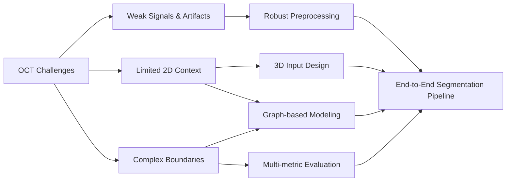
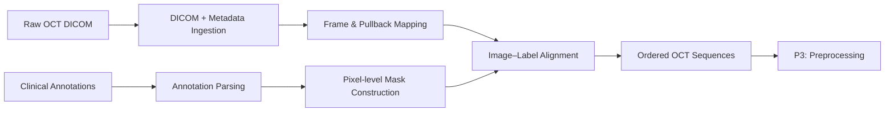
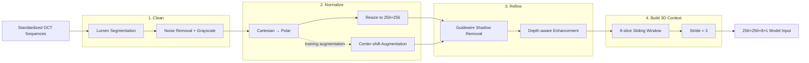
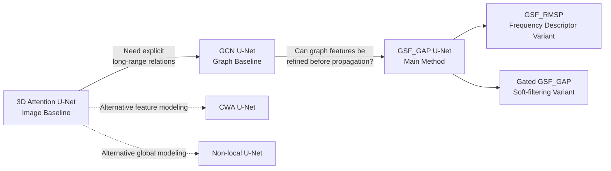
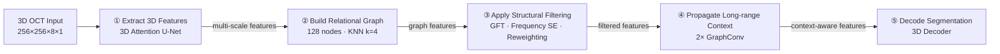
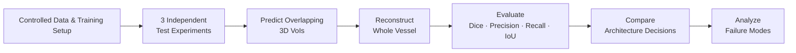

# 3D Deep Learning — Medical AI Image Segmentation

**Role:** ML/AI Engineer — Image segmentation with 3D deep learning and graph-based feature modeling.  
**When:** Jan. 2025 – Jun. 2026 · **Location:** Taipei, Taiwan

> **Disclaimer:** This portfolio presents sanitized project descriptions, aggregated research results, and publication-safe examples.  
> Raw clinical data, identifiable patient information, restricted code, and confidential research materials are not included.

---

## Project at a Glance

| Workstream | Problem | What I Built | Outcome | Key Skills |
|---|---|---|---|---|
| **1. Problem Definition** | Coronary OCT calcification is difficult to segment because of weak signals, artifacts, limited 2D context, and complex lesion boundaries | Translated imaging failure modes into clear requirements for **robustness, wider spatial context, and boundary quality** | Established the technical direction for the full ML pipeline | Problem Framing, Medical Imaging, Segmentation |
| **2. Data Preparation** | Raw clinical OCT scans, metadata, and physician annotations were not directly usable for model training | Built a structured workflow to ingest **34,954 frames**, convert clinical annotations into pixel-level masks, and preserve pullback sequence information | Created a standardized segmentation dataset linking images, labels, metadata, and frame order | Data Engineering, DICOM, Annotation Processing, Dataset Design |
| **3. Preprocessing Pipeline** | Standardized OCT frames still contained imaging noise, artifacts, signal loss, and limited longitudinal context | Built a domain-specific pipeline for **lumen noise removal, polar transformation, guidewire-shadow handling, signal enhancement, augmentation, and 3D VoI construction** | Transformed **704×704 OCT frames into standardized 256×256×8 3D inputs with longitudinal context** | Image Processing, MATLAB, Data Augmentation, 3D Data Pipeline |
| **4. Model Design** | Standard 3D CNNs mainly capture local patterns and may miss wider structural relationships | Built a shared **3D Attention U-Net backbone**, then evaluated **graph message passing, Graph Structural Filtering, and alternative global-context baselines** | Identified **GSF_GAP** as the strongest overall model with mean **3D Dice 0.834** | Deep Learning, 3D CNN, GNN, Architecture Design |
| **5. Evaluation & Results** | Model improvements needed to be validated across full vessels and repeated experiments rather than individual VoIs or one favorable split | Reconstructed overlapping VoI predictions into full-vessel masks and evaluated models using **Dice, Precision, Recall, IoU, and statistical testing** | Achieved best mean **Dice 0.834** and **IoU 0.703**, while identifying precision–recall trade-offs across architectures | Experiment Design, Statistical Testing, Model Evaluation |

---

# Project Details

## P1 — Problem Definition

**Problem**  
Coronary calcification is difficult to segment in OCT because lesion boundaries can be unclear, deeper tissue has weaker signals, imaging artifacts can hide local structures, and calcified plaques vary greatly in shape and size.

**Solution**  
Defined the task as a **3D medical image segmentation problem** so the model could use both each OCT frame and nearby frames. This led to three main design goals: handle weak-signal regions better, capture wider spatial context, and improve boundary segmentation.

**Technical Highlights**
- **Translated real OCT failure modes into concrete model requirements:** robustness to weak signals and artifacts, stronger spatial-context modeling, and accurate boundary segmentation.
- **Moved beyond frame-by-frame segmentation by designing a 3D input setup**, allowing the model to learn lesion continuity across neighboring OCT slices.
- **Built the technical roadmap around these constraints**, connecting preprocessing, 3D volume construction, graph-based feature modeling, and evaluation into one end-to-end segmentation workflow.

**Impact**
- **Established a clear technical direction for the full ML pipeline**, turning clinical imaging challenges into specific decisions for preprocessing, 3D input design, graph-based modeling, and evaluation.

**Architecture / Workflow**

[Deep Dive →](docs/01_problem.md)

---

## P2 — Data Preparation

**Problem Snapshot**

| Challenge | Why It Matters |
|---|---|
| **Raw clinical data** | 34,954 OCT frames came from 138 patients and 192 pullbacks, with separate image, metadata, and annotation sources |
| **Clinical annotations** | Physician-defined coordinates were not directly usable as segmentation masks |
| **Sequential structure** | Frame order within each pullback had to be preserved for later 3D modeling |

**Engineering Response**

| Decision | What I Built |
|---|---|
| **Structured ingestion** | Read OCT DICOM images and metadata and linked them by patient, pullback, and frame |
| **Label construction** | Converted two-physician consensus annotations into pixel-level segmentation masks |
| **Sequence preservation** | Maintained frame order and image-mask alignment to create standardized OCT sequences |

**Technical Highlights**
- Processed **34,954 OCT frames from 138 patients and 192 pullbacks**, including **26,648 calcified** and **8,306 non-calcified frames**.
- Preserved **frame order and pullback continuity** using OCT metadata, keeping the longitudinal structure required for later 3D modeling.
- Standardized image-mask mapping and geometry across the dataset to create a consistent interface for the preprocessing pipeline.

**Impact**
- **Established a structured, model-ready OCT dataset**, providing a reliable foundation for downstream preprocessing and 3D model development.

**Architecture / Workflow**

[Deep Dive →](docs/02_data.md)

---

## P3 — Preprocessing Pipeline

**Problem Snapshot**

| Challenge | Why It Matters |
|---|---|
| **Imaging noise & artifacts** | Lumen-region noise and guidewire shadows could introduce misleading features |
| **Weak deep-tissue signals** | Calcification farther from the lumen can have lower contrast and unclear boundaries |
| **OCT geometry** | Raw Cartesian images do not naturally represent the radial vessel-wall structure |
| **Limited 2D context** | A single frame cannot capture lesion continuity along the vessel |

**Engineering Response**

| Decision | What I Built |
|---|---|
| **Clean the signal** | Removed lumen-region noise before downstream processing |
| **Normalize & vary the geometry** | Converted Cartesian OCT frames to a 256×256 polar representation and generated center-shift variations during transformation |
| **Refine tissue features** | Removed guidewire shadows and enhanced weak deep-tissue signals |
| **Build 3D context** | Constructed overlapping 8-slice 3D VoIs with stride 3 |

**Technical Highlights**
- Used **U-Net-based lumen segmentation** to remove lumen-region noise before downstream image processing.
- Transformed OCT frames from **Cartesian to 256×256 polar coordinates** and introduced **center-shift augmentation** through alternative transformation centers.
- Combined **guidewire-shadow removal and depth-aware signal enhancement** to reduce artifacts and strengthen weak deep-tissue features.
- Constructed overlapping **8-slice 3D VoIs with stride 3**, producing **256×256×8×1 inputs** that preserve longitudinal lesion context.

**Impact**
- **Built a robust 3D input pipeline for volumetric segmentation**, reducing OCT-specific noise while preserving vessel structure and longitudinal lesion context.

**Architecture / Workflow**

[Deep Dive →](docs/03_pipeline.md)

---

## P4 — Model Design

> **Design Goal:** Extend a shared 3D segmentation backbone with explicit graph-based long-range modeling, then refine graph features before message passing through Graph Structural Filtering.

### Architecture Evolution

> **Design progression:** 3D feature extraction → graph-based long-range modeling → Graph Structural Filtering.

---

### Key Design Decisions

| Area | Decision | Engineering Rationale |
|---|---|---|
| **3D Backbone** | 8 slices · 32 base channels · GroupNorm | Improve cross-slice context and stabilize small-batch training |
| **Graph Representation** | 128 nodes · KNN `k=4` | Reduce graph computation while preserving the 8-slice depth structure |
| **Message Passing** | 2× GraphConv + residual connections | Aggregate relational context while preserving node features |
| **Structural Filtering** | GFT + Frequency SE | Adapt graph-frequency contributions before propagation |

### Technical Highlights

- **Designed a 3D Attention U-Net backbone** with multi-scale and cross-slice feature extraction using ASPP, depth-dilated Conv3D, and attention-gated skip connections.
- **Built a compact graph representation** from multi-scale CNN features using 128 nodes, KNN connectivity, and residual GraphConv for long-range dependency modeling.
- **Developed Graph Structural Filtering (GSF)** with Graph Fourier Transform and Frequency SE to adaptively reweight graph-frequency components before message passing.

**Validation design:** GAP vs. RMSP vs. soft gating, with CWA and Non-local attention as alternative modeling baselines.

### Architecture Pipeline

**How it works:** The backbone first extracts **3D spatial and cross-slice features**. These features are compressed into a **128-node KNN graph** to model long-range relationships. GSF then **reweights graph-frequency information before message passing**, and the refined graph features are decoded into the final segmentation mask.

### Impact

- Established a controlled model design that separates the effects of the **3D backbone, graph message passing, and Graph Structural Filtering**.
- **GSF_GAP U-Net achieved the highest mean 3D Dice of 0.834**, outperforming both the U-Net and GCN baselines.

[Model Design Deep Dive →](docs/04_model_design.md)

---

## P5 — Model Validation & Results

> **Validation Goal:** Build a controlled evaluation framework to determine whether graph modeling and Graph Structural Filtering provide measurable value beyond the 3D segmentation baseline.

### Validation Framework

| Design Choice | Implementation | Purpose |
|---|---|---|
| **Controlled comparison** | Same preprocessing, training conditions, and train/validation/test cases within each experiment | Keep data differences from driving model comparisons |
| **Repeated testing** | 3 disjoint test sets · 45 / 43 / 46 vessels · 134 total | Reduce dependence on a single data split |
| **Whole-vessel evaluation** | Reconstructed overlapping VoI predictions before scoring | Evaluate the final vessel-level segmentation rather than individual VoIs |
| **Multi-metric analysis** | 3D Dice · Precision · Recall · IoU | Separate overall overlap from false-positive and false-negative behavior |

### Validation Pipeline

**Evaluation principle:** Model outputs were first mapped back to their original slice positions and overlapping probabilities were averaged before whole-vessel scoring. This prevents individual overlapping VoIs from being treated as independent evaluation cases.

### Architecture Evidence

| Architecture Step | Mean 3D Dice | Change |
|---|---:|---:|
| **3D U-Net** | 0.818 | Baseline |
| **+ Graph Representation & Message Passing** | 0.823 | +0.005 |
| **+ Graph Structural Filtering — GSF_GAP** | **0.834** | **+0.011 vs. GCN · +0.016 vs. U-Net** |

**Key finding:** The largest architecture-stage improvement appeared after adding **Graph Structural Filtering before message passing**, while graph modeling alone produced a smaller gain over the convolutional baseline.

### Prediction Behavior

| Observation | Result | Engineering Interpretation |
|---|---:|---|
| **Best overall overlap** | GSF_GAP · **Dice 0.834 ± 0.033** | Best balance between lesion coverage and false-positive control |
| **Highest Precision** | GSF_RMSP · **0.824 ± 0.032** | Magnitude-based frequency descriptors produced more conservative predictions |
| **Highest Recall** | U-Net · **0.861 ± 0.029** | Broader lesion coverage came with more false positives |
| **Soft gating** | Gated GSF_GAP · Dice 0.830 | Additional filtering increased Precision but did not improve mean Dice |

### Reliability Check

- Used **three mutually exclusive test sets** instead of reporting a single favorable split.
- Compared all models on the **same cases within each experiment**.
- Performed paired case-level comparisons across the **134 test vessels**.
- Raw statistical comparisons were treated as **exploratory**, since 21 pairwise tests were performed without multiple-comparison correction.
- Differences among the three GSF variants were not strong enough to support a clear statistical separation.

### Impact

- Built a **whole-vessel model validation pipeline** spanning repeated testing, reconstruction, multi-metric evaluation, and failure analysis.
- GSF_GAP achieved the highest mean **3D Dice of 0.834**, improving by **0.016 over U-Net** and **0.011 over GCN U-Net**.
- Identified how architecture changes affected not only leaderboard performance, but also **Precision–Recall behavior, cross-split consistency, and failure modes**.

[Model Validation & Results Deep Dive →](docs/05_experiments_results.md)

---

## Key Engineering Takeaways

_TODO_

---

## Tech Stack

| Area | Technologies |
|---|---|
| Programming | _TODO_ |
| Deep Learning | _TODO_ |
| Graph Learning | _TODO_ |
| Image Processing | _TODO_ |
| Experimentation | _TODO_ |
| Visualization | _TODO_ |
| Compute / Engineering | _TODO_ |

---

## Context / Disclaimer

**Project Context**  
_TODO_

**Data Privacy**  
_TODO_

**Repository Scope**  
_TODO_
