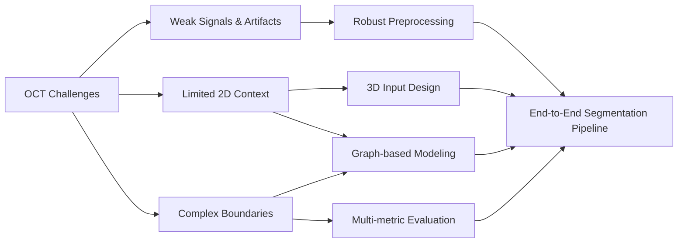
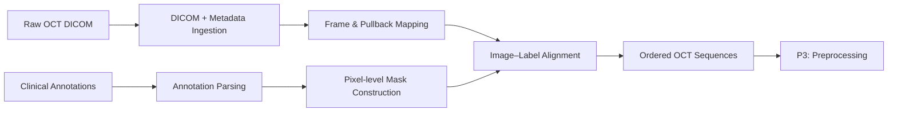
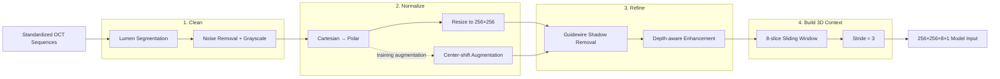
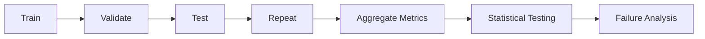

# 3D Deep Learning — Medical AI Image Segmentation

**Role:** ML/AI Engineer — Image segmentation with 3D deep learning and graph-based feature modeling.  
**When:** Jan. 2025 – Jun. 2026 · **Location:** Taipei, Taiwan

> **Disclaimer:** This portfolio presents sanitized project descriptions, aggregated research results, and publication-safe examples.  
> Raw clinical data, identifiable patient information, restricted code, and confidential research materials are not included.

---

## Project at a Glance

| Workstream | Problem | What I Built | Outcome | Key Skills |
|---|---|---|---|---|
| **1. Problem Definition** | Coronary OCT calcification is difficult to segment because of weak signals, artifacts, limited 2D context, and complex lesion boundaries | Translated imaging failure modes into clear requirements for **robustness, wider spatial context, and boundary quality** | Established the technical direction for the full ML pipeline | Problem Framing, Medical Imaging, Segmentation |
| **2. Data Preparation** | Raw clinical OCT scans, metadata, and physician annotations were not directly usable for model training | Built a structured workflow to ingest **34,954 frames**, convert clinical annotations into pixel-level masks, and preserve pullback sequence information | Created a standardized segmentation dataset linking images, labels, metadata, and frame order | Data Engineering, DICOM, Annotation Processing, Dataset Design |
| **3. Preprocessing Pipeline** | Standardized OCT frames still contained imaging noise, artifacts, signal loss, and limited longitudinal context | Built a domain-specific pipeline for **lumen noise removal, polar transformation, guidewire-shadow handling, signal enhancement, augmentation, and 3D VoI construction** | Transformed **704×704 OCT frames into standardized 256×256×8 3D inputs with longitudinal context** | Image Processing, MATLAB, Data Augmentation, 3D Data Pipeline |
| **4. Model Design** | Standard 3D CNNs mainly capture local patterns and may miss wider structural relationships | Developed and compared **3D U-Net, attention, GCN, graph structural filtering, gated fusion, and non-local** architectures | Identified **GSF_GAP** as the strongest overall model with mean **3D Dice 0.834** | Deep Learning, 3D CNN, GNN, Architecture Design |
| **5. Evaluation & Results** | Model improvements needed to be validated across full vessels and repeated experiments rather than individual VoIs or one favorable split | Reconstructed overlapping VoI predictions into full-vessel masks and evaluated models using **Dice, Precision, Recall, IoU, and statistical testing** | Achieved best mean **Dice 0.834** and **IoU 0.703**, while identifying precision–recall trade-offs across architectures | Experiment Design, Statistical Testing, Model Evaluation |

---

# Project Details

## P1 — Problem Definition

**Problem**  
Coronary calcification is difficult to segment in OCT because lesion boundaries can be unclear, deeper tissue has weaker signals, imaging artifacts can hide local structures, and calcified plaques vary greatly in shape and size.

**Solution**  
Defined the task as a **3D medical image segmentation problem** so the model could use both each OCT frame and nearby frames. This led to three main design goals: handle weak-signal regions better, capture wider spatial context, and improve boundary segmentation.

**Technical Highlights**
- **Translated real OCT failure modes into concrete model requirements:** robustness to weak signals and artifacts, stronger spatial-context modeling, and accurate boundary segmentation.
- **Moved beyond frame-by-frame segmentation by designing a 3D input setup**, allowing the model to learn lesion continuity across neighboring OCT slices.
- **Built the technical roadmap around these constraints**, connecting preprocessing, 3D volume construction, graph-based feature modeling, and evaluation into one end-to-end segmentation workflow.

**Impact**
- **Established a clear technical direction for the full ML pipeline**, turning clinical imaging challenges into specific decisions for preprocessing, 3D input design, graph-based modeling, and evaluation.

**Architecture / Workflow**

[Deep Dive →](docs/01_problem.md)

---

## P2 — Data Preparation

**Problem Snapshot**

| Challenge | Why It Matters |
|---|---|
| **Raw clinical data** | 34,954 OCT frames came from 138 patients and 192 pullbacks, with separate image, metadata, and annotation sources |
| **Clinical annotations** | Physician-defined coordinates were not directly usable as segmentation masks |
| **Sequential structure** | Frame order within each pullback had to be preserved for later 3D modeling |

**Engineering Response**

| Decision | What I Built |
|---|---|
| **Structured ingestion** | Read OCT DICOM images and metadata and linked them by patient, pullback, and frame |
| **Label construction** | Converted two-physician consensus annotations into pixel-level segmentation masks |
| **Sequence preservation** | Maintained frame order and image-mask alignment to create standardized OCT sequences |

**Technical Highlights**
- Processed **34,954 OCT frames from 138 patients and 192 pullbacks**, including **26,648 calcified** and **8,306 non-calcified frames**.
- Preserved **frame order and pullback continuity** using OCT metadata, keeping the longitudinal structure required for later 3D modeling.
- Standardized image-mask mapping and geometry across the dataset to create a consistent interface for the preprocessing pipeline.

**Impact**
- **Established a structured, model-ready OCT dataset**, providing a reliable foundation for downstream preprocessing and 3D model development.

**Architecture / Workflow**

[Deep Dive →](docs/02_data.md)

---

## P3 — Preprocessing Pipeline

**Problem Snapshot**

| Challenge | Why It Matters |
|---|---|
| **Imaging noise & artifacts** | Lumen-region noise and guidewire shadows could introduce misleading features |
| **Weak deep-tissue signals** | Calcification farther from the lumen can have lower contrast and unclear boundaries |
| **OCT geometry** | Raw Cartesian images do not naturally represent the radial vessel-wall structure |
| **Limited 2D context** | A single frame cannot capture lesion continuity along the vessel |

**Engineering Response**

| Decision | What I Built |
|---|---|
| **Clean the signal** | Removed lumen-region noise before downstream processing |
| **Normalize & vary the geometry** | Converted Cartesian OCT frames to a 256×256 polar representation and generated center-shift variations during transformation |
| **Refine tissue features** | Removed guidewire shadows and enhanced weak deep-tissue signals |
| **Build 3D context** | Constructed overlapping 8-slice 3D VoIs with stride 3 |

**Technical Highlights**
- Used **U-Net-based lumen segmentation** to remove lumen-region noise before downstream image processing.
- Transformed OCT frames from **Cartesian to 256×256 polar coordinates** and introduced **center-shift augmentation** through alternative transformation centers.
- Combined **guidewire-shadow removal and depth-aware signal enhancement** to reduce artifacts and strengthen weak deep-tissue features.
- Constructed overlapping **8-slice 3D VoIs with stride 3**, producing **256×256×8×1 inputs** that preserve longitudinal lesion context.

**Impact**
- **Built a robust 3D input pipeline for volumetric segmentation**, reducing OCT-specific noise while preserving vessel structure and longitudinal lesion context.

**Architecture / Workflow**

[Deep Dive →](docs/03_pipeline.md)

---

## P4 — Model Design

> **Design Goal:** Extend a strong 3D segmentation backbone from local image modeling to explicit long-range graph reasoning, then improve graph message passing through adaptive graph-frequency filtering.

### Architecture Evolution

The model family was designed as a sequence of technical questions rather than a collection of independent architectures.

| Step | Limitation to Address | Design Response | Model |
|---|---|---|---|
| **1. Build strong 3D features** | Calcification extends across slices and varies in scale | 3D convolution, multi-scale context, depth-aware receptive field, attention-guided decoding | **U-Net** |
| **2. Add long-range relations** | CNN features interact mainly through local convolution | Convert multi-scale features into graph nodes and perform KNN-based message passing | **GCN U-Net** |
| **3. Improve graph information** | Feature-similar KNN connections may contain irrelevant or noisy structural relationships | Decompose graph signals into frequency components and adaptively reweight them before message passing | **GSF_GAP U-Net** |
| **4. Test GSF design choices** | Frequency importance can be described or filtered in different ways | Compare GAP, RMSP, and learnable soft gating | **GSF_RMSP / Gated GSF_GAP** |
| **5. Benchmark other strategies** | Improvements should be separated from generic attention or global-context effects | Compare with image-space feature weighting and graph-free dense global attention | **CWA / Non-local U-Net** |

The final design therefore follows:

> **3D Image Modeling → Graph Relation Modeling → Graph Structural Filtering**

---

### Model Family

Each model has a clear role:

- **U-Net** — 3D image baseline
- **GCN U-Net** — graph message-passing baseline
- **GSF_GAP U-Net** — main graph-frequency filtering method
- **GSF variants** — test alternative frequency weighting and gating designs
- **CWA / Non-local U-Net** — benchmark alternative feature and global-context modeling strategies

---

### Key Design Decisions

| Component | Design Choice | Rationale |
|---|---|---|
| **Backbone** | 8 slices, 32 base channels, GroupNorm | Stable 3D feature extraction for small-batch training |
| **Graph Representation** | 128 nodes, KNN `k=4` | Capture long-range dependencies with manageable graph size |
| **Graph Propagation** | 2× GraphConv + residual connections | Aggregate relational features while preserving node information |
| **GSF** | GFT + Frequency SE | Reweight graph-frequency components before message passing |
| **Ablations** | GAP / RMSP / soft gate | Isolate frequency descriptor and filtering design choices |

### Technical Highlights

- **Designed a shared 3D Attention U-Net backbone** with GroupNorm, ASPP, depth-dilated Conv3D, and attention-gated skip connections for multi-scale and cross-slice feature extraction.
- **Compressed multi-scale CNN features into 128 graph nodes** and built a `k=4` KNN graph for explicit long-range message passing with two residual GraphConv layers.
- **Developed Graph Structural Filtering (GSF)** using Graph Fourier Transform and Frequency Squeeze-and-Excitation to adaptively reweight graph-frequency components before propagation.
- **Built controlled ablation and comparison models** across GAP, RMSP, soft gating, CWA, and Non-local attention to isolate the contribution of each architectural choice.

### Architecture Pipeline

```mermaid
flowchart LR
    X["3D OCT Volume<br/>256×256×8×1"]

    subgraph B["3D Feature Backbone"]
        B1["3D Attention U-Net"]
        B2["Multi-scale Features<br/>ASPP + Depth-aware Conv3D"]
        B1 --> B2
    end

    subgraph G["Graph Representation"]
        G1["Graph Projection<br/>4×4×8 = 128 Nodes"]
        G2["KNN Graph<br/>k = 4"]
        G1 --> G2
    end

    subgraph S["Graph Structural Filtering"]
        S1["Graph Fourier Transform"]
        S2["Frequency SE"]
        S3["Spectral Reweighting<br/>+ Residual Fusion"]
        S1 --> S2 --> S3
    end

    M["2× GraphConv<br/>Message Passing"]
    D["Segmentation Decoder"]

    X --> B1
    B2 --> G1
    G2 --> S1
    S3 --> M
    M --> D
```

| Stage | Engineering Role |
|---|---|
| **3D Feature Backbone** | Extract multi-scale spatial and cross-slice features |
| **Graph Representation** | Compress CNN features into a compact relational graph |
| **Graph Structural Filtering** | Reweight graph-frequency components before message passing |

### Comparison Baselines

**CWA U-Net** provides image-space feature reweighting, while **Non-local U-Net** provides graph-free global attention for comparison against the graph-based GCN / GSF models.

### Impact

- Built a **controlled architecture framework** that isolates the contributions of 3D feature extraction, graph message passing, and graph-frequency filtering.
- **GSF_GAP U-Net achieved the highest mean 3D Dice of 0.834**, outperforming both the U-Net and GCN baselines.

[Model Design Deep Dive →](docs/04_model_design.md)

---

## P5 — Experiment & Results

**Problem**  
_TODO_

**Solution**  
_TODO_

**Technical Highlights**
- _TODO_
- _TODO_
- _TODO_

**Impact**
- _TODO_

**Architecture / Workflow**

[Deep Dive →](docs/05_experiments_results.md)

---

## Key Engineering Takeaways

_TODO_

---

## Tech Stack

| Area | Technologies |
|---|---|
| Programming | _TODO_ |
| Deep Learning | _TODO_ |
| Graph Learning | _TODO_ |
| Image Processing | _TODO_ |
| Experimentation | _TODO_ |
| Visualization | _TODO_ |
| Compute / Engineering | _TODO_ |

---

## Context / Disclaimer

**Project Context**  
_TODO_

**Data Privacy**  
_TODO_

**Repository Scope**  
_TODO_
