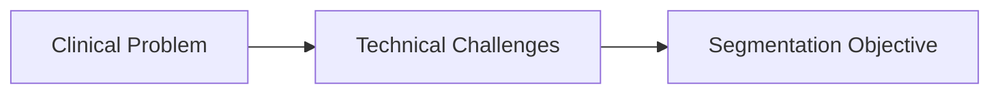
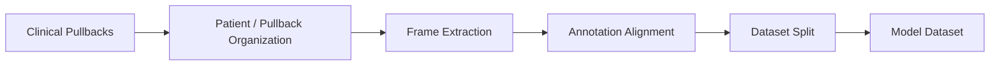
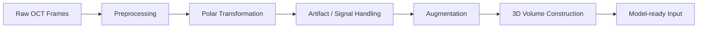
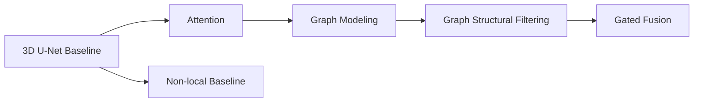
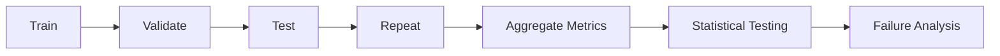

# 3D Deep Learning — Medical AI Image Segmentation

**Coronary OCT segmentation with 3D deep learning and graph-based feature modeling.**

---

## Project at a Glance

| Module | Problem | What I Built | Result / Output | Key Skills |
|---|---|---|---|---|
| **1. Problem** | _TODO_ | _TODO_ | _TODO_ | _TODO_ |
| **2. Data** | _TODO_ | _TODO_ | _TODO_ | _TODO_ |
| **3. Pipeline** | _TODO_ | _TODO_ | _TODO_ | _TODO_ |
| **4. Model Design** | _TODO_ | _TODO_ | _TODO_ | _TODO_ |
| **5. Experiment & Results** | _TODO_ | _TODO_ | _TODO_ | _TODO_ |

---

# Project Details

## P1 — Problem

**Problem**  
_TODO_

**Solution**  
_TODO_

**Technical Highlights**
- _TODO_
- _TODO_
- _TODO_

**Impact**
- _TODO_

**Architecture / Workflow**

[Deep Dive →](docs/01_problem.md)

---

## P2 — Data

**Problem**  
_TODO_

**Solution**  
_TODO_

**Technical Highlights**
- _TODO_
- _TODO_
- _TODO_

**Impact**
- _TODO_

**Architecture / Workflow**

[Deep Dive →](docs/02_data.md)

---

## P3 — Pipeline

**Problem**  
_TODO_

**Solution**  
_TODO_

**Technical Highlights**
- _TODO_
- _TODO_
- _TODO_

**Impact**
- _TODO_

**Architecture / Workflow**

[Deep Dive →](docs/03_pipeline.md)

---

## P4 — Model Design

**Problem**  
_TODO_

**Solution**  
_TODO_

**Technical Highlights**
- _TODO_
- _TODO_
- _TODO_

**Impact**
- _TODO_

**Architecture / Workflow**

[Deep Dive →](docs/04_model_design.md)

---

## P5 — Experiment & Results

**Problem**  
_TODO_

**Solution**  
_TODO_

**Technical Highlights**
- _TODO_
- _TODO_
- _TODO_

**Impact**
- _TODO_

**Architecture / Workflow**

[Deep Dive →](docs/05_experiments_results.md)

---

## Key Engineering Takeaways

_TODO_

---

## Tech Stack

| Area | Technologies |
|---|---|
| Programming | _TODO_ |
| Deep Learning | _TODO_ |
| Graph Learning | _TODO_ |
| Image Processing | _TODO_ |
| Experimentation | _TODO_ |
| Visualization | _TODO_ |
| Compute / Engineering | _TODO_ |

---

## Context / Disclaimer

**Project Context**  
_TODO_

**Data Privacy**  
_TODO_

**Repository Scope**  
_TODO_
