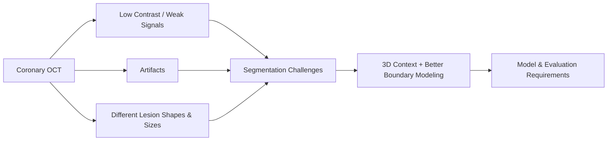
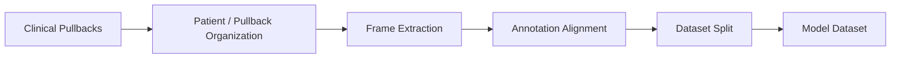
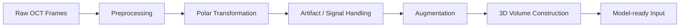
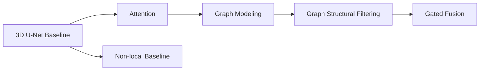
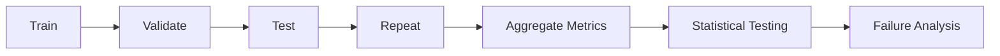

# 3D Deep Learning — Medical AI Image Segmentation

**Role:** ML/AI Engineer — Image segmentation with 3D deep learning and graph-based feature modeling.  
**When:** Jan. 2025 – Jun. 2026 · **Location:** Taipei, Taiwan

> **Disclaimer:** This portfolio presents sanitized project descriptions, aggregated research results, and publication-safe examples.  
> Raw clinical data, identifiable patient information, restricted code, and confidential research materials are not included.

---

## Project at a Glance

| Workstream | Problem | What I Built | Outcome | Key Skills |
|---|---|---|---|---|
| **1. Problem Definition** | Coronary OCT calcification is difficult to segment because of low contrast, signal attenuation, artifacts, and highly variable lesion morphology | Framed the task as a **3D medical image segmentation problem** and identified key failure modes that should guide model design | Defined clear technical objectives for robustness, spatial-context modeling, and boundary delineation | Problem Framing, Medical Imaging, Segmentation |
| **2. Data Preparation** | Clinical OCT data were large-scale, heterogeneous, and required patient-level organization before training | Structured **138 patients, 192 pullbacks, and 34,954 frames** into a consistent dataset with controlled train/validation/test organization | Created a reproducible dataset foundation for model development and fair comparison | Data Processing, Dataset Design, Data Validation |
| **3. Preprocessing Pipeline** | Raw 2D OCT frames were not directly suitable for volumetric learning | Built an end-to-end pipeline for **polar transformation, artifact handling, signal enhancement, augmentation, and 3D volume construction** | Converted **704×704 frames into 256×256×8 model-ready volumes** with longitudinal context | Python, Image Processing, Data Pipeline, 3D Data |
| **4. Model Design** | Standard 3D CNNs mainly capture local context and may underrepresent long-range structural relationships | Developed and compared **3D U-Net, attention, GCN, graph structural filtering, gated fusion, and non-local** architectures | Identified **GSF_GAP** as the strongest overall model with mean **3D Dice 0.834** | Deep Learning, 3D CNN, GNN, Architecture Design |
| **5. Evaluation & Results** | Architecture improvements needed to be validated across repeated experiments rather than a single split | Designed repeated train/validation/test experiments with **Dice, Precision, Recall, IoU, paired t-tests, and Friedman testing** | Achieved best mean **Dice 0.834** and **IoU 0.703**, while quantifying precision–recall trade-offs across models | Experiment Design, Statistical Testing, Model Evaluation |

---

# Project Details

## P1 — Problem Definition

**Problem**  
Coronary calcification is difficult to segment in OCT because lesion boundaries can be unclear, deeper tissue has weaker signals, imaging artifacts can hide local structures, and calcified plaques vary greatly in shape and size.

**Solution**  
Defined the task as a **3D medical image segmentation problem** so the model could use both each OCT frame and nearby frames. This led to three main design goals: handle weak-signal regions better, capture wider spatial context, and improve boundary segmentation.

**Technical Highlights**
- Identified key failure modes: **low contrast, signal attenuation, guidewire artifacts, and large differences in lesion shape and size**.
- Used a **3D segmentation setup** instead of treating each OCT frame independently.
- Used these failure modes to guide the later preprocessing, graph-based model design, and evaluation strategy.

**Impact**
- Turned the clinical imaging challenge into clear engineering requirements for the **data pipeline, model architecture, and evaluation setup**.

**Architecture / Workflow**

[Deep Dive →](docs/01_problem.md)

---

## P2 — Data

**Problem**  
_TODO_

**Solution**  
_TODO_

**Technical Highlights**
- _TODO_
- _TODO_
- _TODO_

**Impact**
- _TODO_

**Architecture / Workflow**

[Deep Dive →](docs/02_data.md)

---

## P3 — Pipeline

**Problem**  
_TODO_

**Solution**  
_TODO_

**Technical Highlights**
- _TODO_
- _TODO_
- _TODO_

**Impact**
- _TODO_

**Architecture / Workflow**

[Deep Dive →](docs/03_pipeline.md)

---

## P4 — Model Design

**Problem**  
_TODO_

**Solution**  
_TODO_

**Technical Highlights**
- _TODO_
- _TODO_
- _TODO_

**Impact**
- _TODO_

**Architecture / Workflow**

[Deep Dive →](docs/04_model_design.md)

---

## P5 — Experiment & Results

**Problem**  
_TODO_

**Solution**  
_TODO_

**Technical Highlights**
- _TODO_
- _TODO_
- _TODO_

**Impact**
- _TODO_

**Architecture / Workflow**

[Deep Dive →](docs/05_experiments_results.md)

---

## Key Engineering Takeaways

_TODO_

---

## Tech Stack

| Area | Technologies |
|---|---|
| Programming | _TODO_ |
| Deep Learning | _TODO_ |
| Graph Learning | _TODO_ |
| Image Processing | _TODO_ |
| Experimentation | _TODO_ |
| Visualization | _TODO_ |
| Compute / Engineering | _TODO_ |

---

## Context / Disclaimer

**Project Context**  
_TODO_

**Data Privacy**  
_TODO_

**Repository Scope**  
_TODO_
