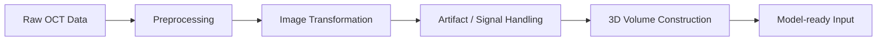
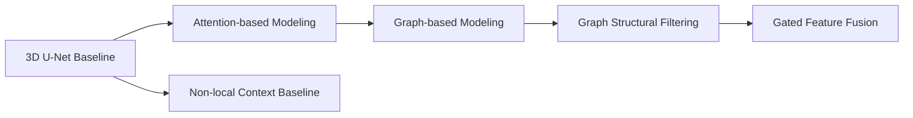
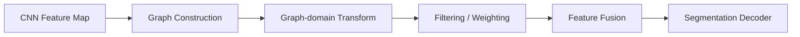

# 3D Deep Learning — Medical AI Image Segmentation

**Coronary OCT segmentation with 3D deep learning and graph-based feature modeling.**

> This README is intentionally structured as an engineering portfolio. Each section will be filled progressively with the final project content.

---

## Project Context

**What should this section answer?**

- What is the project?
- What was my role?
- What technical area does it belong to?
- What should a hiring manager understand within the first 20 seconds?
- What data or publication restrictions should be stated upfront?

---

## Project at a Glance

| Problem | What I Built | Scale | Best Result | Stack |
|---|---|---|---|---|
| _TODO_ | _TODO_ | _TODO_ | _TODO_ | _TODO_ |

**What should this section answer?**

- What was the technical problem?
- What did I personally build?
- How large / complex was the project?
- What was the strongest measurable result?
- What core technologies were used?

---

## 01. Problem

### Problem

_TODO_

### Why This Is Technically Challenging

_TODO_

**Questions to answer**

- What exactly are we trying to segment?
- Why is coronary OCT difficult for automated segmentation?
- What makes this more challenging than a clean benchmark dataset?
- What are the main sources of ambiguity, noise, or failure?
- What technical objective did the project aim to improve?

---

## 02. Data & Preprocessing Pipeline

### Input Data

_TODO_

### What I Built

_TODO_

### Pipeline Overview



**Questions to answer**

- What raw data did I receive?
- How many patients, pullbacks, frames, and annotations were involved?
- What preprocessing steps were necessary before modeling?
- Why were those preprocessing steps needed?
- How were 2D frames converted into 3D model inputs?
- Which parts of the pipeline did I implement?

---

## 03. Model Development

### Baseline

_TODO_

### Model Evolution



### Why Each Modification Was Introduced

_TODO_

**Questions to answer**

- What was the baseline architecture?
- What limitations did I observe or hypothesize?
- Why did I introduce attention?
- Why did I introduce graph modeling?
- Why was GSF needed?
- What alternative contextual modeling approach was used for comparison?
- Which architectural choices were experimental, and which became final?

---

## 04. GSF Technical Deep Dive

### Problem with Naive Graph Modeling

_TODO_

### Proposed Approach

_TODO_

### Technical Highlights

- _TODO: graph pooling / node construction_
- _TODO: graph connectivity_
- _TODO: graph Fourier transform_
- _TODO: filtering / weighting_
- _TODO: feature fusion_
- _TODO: gated variant_

### Architecture Overview



**Questions to answer**

- What specific problem was GSF designed to solve?
- How were graph nodes constructed?
- How were graph relationships defined?
- Where was the graph Fourier transform used?
- How were graph-domain features filtered or reweighted?
- How were graph features fused back into the CNN stream?
- What is different between GSF_GAP, GSF_RMSP, and Gated GSF?

---

## 05. Experiments & Results

### Evaluation Setup

_TODO_

### Quantitative Results

| Model | Dice | Precision | Recall | IoU |
|---|---:|---:|---:|---:|
| _TODO_ |  |  |  |  |

### Statistical Validation

_TODO_

### Key Findings

_TODO_

**Questions to answer**

- How were train / validation / test splits designed?
- How many independent experiments were run?
- What metrics were used?
- How was statistical significance evaluated?
- Which model performed best?
- What trade-offs existed between Dice, precision, and recall?
- Which improvements were consistent versus marginal?

---

## 06. Qualitative Results & Failure Cases

### Where the Model Works Well

_TODO_

### Where the Model Still Fails

_TODO_

### Visual Comparison

_To be added: Input | Ground Truth | Baseline | Best Model_

**Questions to answer**

- Which lesion patterns were segmented well?
- Which cases remained difficult?
- How did the best model differ visually from the baseline?
- What failure modes appeared repeatedly?
- What did these failure cases teach me about the model?

---

## 07. Tech Stack

| Area | Technologies |
|---|---|
| Deep Learning | _TODO_ |
| Graph Modeling | _TODO_ |
| Image Processing | _TODO_ |
| Experimentation | _TODO_ |
| Visualization | _TODO_ |
| Engineering | _TODO_ |

---

## 08. Key Engineering Takeaways

_TODO_

**Questions to answer**

- What were the most important engineering decisions?
- What trade-offs did I make because of compute, memory, or data constraints?
- What did I learn about preprocessing versus model complexity?
- Which ideas did not work as expected?
- What would I change if rebuilding the system today?
- What does this project demonstrate about my ML engineering ability?

---

## 09. Repository Structure

```text
3D-DLimage-segmentation/
├── README.md
├── docs/
├── assets/
│   ├── overview/
│   ├── pipeline/
│   ├── architecture/
│   └── results/
├── preprocessing/
├── models/
├── training/
├── evaluation/
├── configs/
├── notebooks/
├── requirements.txt
├── LICENSE
└── .gitignore
```

---

## 10. Reproduction

_TODO_

**Questions to answer**

- What environment is required?
- How are dependencies installed?
- How is preprocessing executed?
- How is model training launched?
- How is evaluation reproduced?
- Which components cannot be reproduced because the clinical dataset is private?

---

## 11. Data & Research Disclaimer

_TODO_

**Questions to answer**

- What clinical data cannot be shared?
- What identifiable or restricted materials are excluded?
- What code can be released safely?
- Are figures or results subject to manuscript / institutional restrictions?
- What can future users reproduce with synthetic or public data?

---

## 12. Citation / Contact

_TODO_
