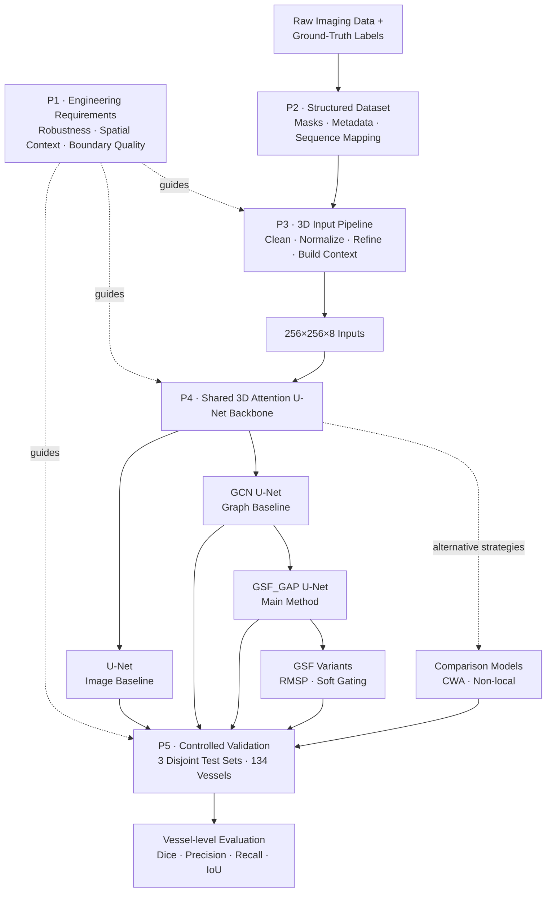
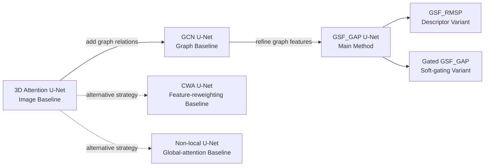

# 3D Deep Learning — Medical AI Image Segmentation

**Project:** End-to-end ML pipeline for Medical AI Image Segmentation.

**Role:** ML/AI Engineer — 3D image segmentation, graph learning, and model validation.  
**When:** Jan. 2025 – Jun. 2026 · **Location:** Taipei, Taiwan  
**Project scale:** 34,954 frames · 138 patients · 7 model variants · 134 test vessels

---

## Project at a Glance

| Workstream | Core Challenge | Engineering Response | Outcome |
|---|---|---|---|
| **[P1 — Problem Definition](#p1--problem-definition)** | Weak signals · artifacts · limited 2D context | Defined requirements for **robustness, spatial context, and boundary quality** | Set the technical direction for the full ML pipeline |
| **[P2 — Data Preparation](#p2--data-preparation)** | Images, metadata, and labels were disconnected | Structured **34,954 frames** with masks and sequence mapping | Built an ordered, model-ready dataset |
| **[P3 — Preprocessing Pipeline](#p3--preprocessing-pipeline)** | Noise, artifacts, and weak deep-tissue signals | Polar transform · artifact handling · signal enhancement · 8-slice VoIs | Produced standardized **256×256×8** 3D inputs |
| **[P4 — Model Design](#p4--model-design)** | Local CNN features alone may miss long-range structure | Built a controlled **3D U-Net → GCN → GSF** model family | **GSF_GAP** achieved the highest mean Dice: **0.834** |
| **[P5 — Model Validation & Results](#p5--model-validation--results)** | Single splits and VoI-level scores can mislead | Used **3 disjoint test sets**, vessel-level aggregation, and multi-metric evaluation | Best mean **Dice 0.834** · **IoU 0.703** + trade-off analysis |

---

## End-to-End System Overview



**Storyline:** define the engineering requirements → structure the data → build standardized 3D inputs → compare model strategies → validate them under the same vessel-level framework.

---

## Project Details

### P1 — Problem Definition

> **Key Question —** What must the ML system handle to segment calcification reliably?

#### 1. Highlights
- **3D problem formulation** — used neighboring slices instead of isolated frames.
- **Engineering requirements** — defined **robustness, wider spatial context, and boundary quality** from imaging failure modes.

#### 2. Impact
- Established the technical direction for **preprocessing → 3D input design → graph modeling → evaluation**.

#### 3. Key Takeaway
> Problem framing came before architecture selection, so every downstream design choice addressed a defined failure mode.

#### 4. Next
**P2 → Data Preparation:** Build a reliable dataset that preserves image–label alignment and frame order.

[Deep Dive →](docs/01_problem.md)

---

### P2 — Data Preparation

> **Key Question —** How do we turn disconnected images, metadata, and labels into a reliable dataset for 3D modeling?

#### 1. Highlights
- **Dataset structuring** — organized **34,954 frames from 138 patients and 192 pullbacks**.
- **Label & sequence alignment** — converted reference annotations into pixel-level masks while preserving **frame order, pullback identity, and image–mask alignment**.

#### 2. Impact
- Created an ordered, model-ready dataset and a stable **data contract** for every downstream preprocessing and modeling experiment.

#### 3. Key Takeaway
> Separating data organization from image transformation reduced downstream ambiguity and kept the 3D pipeline reproducible.

#### 4. Next
**P3 → Preprocessing Pipeline:** Transform ordered 2D sequences into standardized 3D model inputs.

[Deep Dive →](docs/02_data.md)

---

### P3 — Preprocessing Pipeline

> **Key Question —** How do we convert ordered 2D sequences into robust, context-aware 3D inputs?

#### 1. Highlights

| Stage | Engineering Action | Purpose |
|---|---|---|
| **Clean** | Lumen-region noise removal | Remove irrelevant signal |
| **Normalize** | Cartesian → polar · resize · center-shift augmentation | Standardize vessel geometry |
| **Refine** | Guidewire-shadow handling · depth-aware enhancement | Improve difficult tissue features |
| **Build 3D Context** | 8-slice sliding window · stride 3 | Preserve longitudinal context |

- **Standardized input** — all model variants use **256×256×8×1** 3D VoIs.
- **Controlled preprocessing** — OCT-specific cleaning, geometry normalization, artifact handling, signal enhancement, and 3D construction are handled before model comparison.

#### 2. Impact
- Produced one consistent 3D input interface across all model variants, allowing P4 comparisons to focus on architecture rather than inconsistent preprocessing.

#### 3. Key Takeaway
> Preprocessing converted domain-specific image problems into a standardized ML input problem.

#### 4. Next
**P4 → Model Design:** Compare local CNN, graph-based, and global-context modeling strategies.

[Deep Dive →](docs/03_pipeline.md)

---

### P4 — Model Design

> **Key Question —** Does explicit graph modeling — and then Graph Structural Filtering — add value beyond the shared 3D CNN backbone?

#### 1. Highlights

##### Architecture Evolution



| Design Layer | Decision | Why |
|---|---|---|
| **3D Backbone** | 8 slices · 32 base channels · GroupNorm | Stable 3D feature extraction |
| **Graph Representation** | 128 nodes · KNN `k=4` | Compact long-range relational model |
| **Message Passing** | 2× GraphConv + residuals | Aggregate graph context |
| **Structural Filtering** | GFT + Frequency SE | Reweight graph-frequency information before propagation |

- **Controlled model family** — **U-Net → GCN U-Net → GSF_GAP U-Net**.
- **Alternative strategies** — CWA, Non-local, RMSP, and soft-gating variants test different representation and filtering choices.

#### 2. Impact
- **GSF_GAP** achieved the highest mean 3D Dice of **0.834**, compared with **0.823 for GCN U-Net** and **0.818 for U-Net**.

#### 3. Key Takeaway
> The strongest architecture-stage gain appeared after refining graph features before message passing, not from graph construction alone.

#### 4. Next
**P5 → Model Validation & Results:** Test whether the architecture gains hold under repeated vessel-level evaluation.

[Model Design Deep Dive →](docs/04_model_design.md)

---

### P5 — Model Validation & Results

> **Key Question —** Do the architecture changes produce repeatable gains under the same data and evaluation setup?

#### 1. Highlights

##### Validation Framework

| Design | Implementation | Why It Matters |
|---|---|---|
| **Controlled comparison** | Same preprocessing, training setup, and data splits | Isolate architecture changes |
| **Repeated testing** | 3 disjoint test sets · 134 vessels | Reduce dependence on one split |
| **Vessel-level evaluation** | Aggregate overlapping VoI predictions before scoring | Evaluate the final output |
| **Multi-metric analysis** | Dice · Precision · Recall · IoU | Capture overlap and error trade-offs |

##### Architecture Evidence

| Architecture Step | Mean 3D Dice | Change |
|---|---:|---:|
| **3D U-Net** | 0.818 | Baseline |
| **+ Graph Modeling** | 0.823 | +0.005 |
| **+ Graph Structural Filtering** | **0.834** | **+0.011 vs. GCN** |

- **Repeated evaluation** — all models were tested across **3 disjoint test sets and 134 vessels** under the same setup.
- **Behavior analysis** — compared Dice, Precision, Recall, IoU, paired case-level differences, and representative failure modes.

#### 2. Impact
- **GSF_GAP** achieved the best mean Dice (**0.834**) and tied the highest IoU (**0.703**), improving mean Dice by **0.016 over U-Net** and **0.011 over GCN U-Net**.

#### 3. Key Takeaway
> GSF produced the strongest architecture-stage gain, but model selection also depended on **Precision–Recall behavior, cross-split consistency, and statistical limits**.

#### 4. Next
See the deep dive for experiment design, paired comparisons, and failure analysis.

[Model Validation & Results Deep Dive →](docs/05_experiments_results.md)

---

## Key Engineering Takeaways

- **Built the full ML path from data structure to model validation**, rather than treating training as an isolated step.
- **Designed controlled architecture experiments** around a shared 3D backbone to isolate the value of graph message passing and GSF.
- **Connected dense CNN features with a compact graph representation**, then applied graph-frequency reweighting before propagation.
- **Evaluated final vessel-level outputs across repeated test sets**, using multiple metrics and failure analysis to avoid choosing a model from one score alone.

---

## Tech Stack

| Area | Technologies / Methods |
|---|---|
| **Programming & Modeling** | Python · TensorFlow · Keras · MATLAB |
| **Deep Learning** | 3D U-Net · Attention U-Net · Conv3D · GroupNorm · ASPP |
| **Graph Learning** | KNN Graph · GCN · GraphConv · Graph Laplacian · Graph Fourier Transform · Frequency SE |
| **Image Processing** | DICOM Processing · Polar Transformation · Artifact Removal · Signal Enhancement · Data Augmentation |
| **Experimentation** | Overlapping Prediction Aggregation · Vessel-level Evaluation · 3D Dice · Precision · Recall · IoU · Paired Statistical Testing |

---

## Selected Code Samples

These files are **sanitized portfolio implementations** extracted from the research workflow. They demonstrate the main engineering ideas without exposing raw clinical data, private file paths, full training infrastructure, or restricted unpublished code.

| Area | Code Sample | What It Demonstrates |
|---|---|---|
| **Preprocessing** | [`polar_transform.py`](src/preprocessing/polar_transform.py) | Generic Cartesian-to-polar image transformation |
| **3D Input Construction** | [`volume_builder.py`](src/preprocessing/volume_builder.py) | Overlapping 8-slice 3D window construction with slice mapping |
| **3D Backbone** | [`unet3d.py`](src/models/unet3d.py) | 3D Attention U-Net, GroupNorm, anisotropic depth handling, ASPP-style context |
| **Graph Construction** | [`graph_builder.py`](src/models/graph_builder.py) | Feature-space KNN graph construction with symmetric adjacency |
| **Graph Message Passing** | [`graph_conv.py`](src/models/graph_conv.py) | Residual graph aggregation and node-feature updates |
| **Graph Structural Filtering** | [`gsf.py`](src/models/gsf.py) | Graph Laplacian, GFT, Frequency SE, inverse transform, residual fusion |
| **Evaluation** | [`metrics.py`](src/evaluation/metrics.py) | Dice, Precision, Recall, and IoU |
| **Prediction Aggregation** | [`prediction_aggregation.py`](src/evaluation/prediction_aggregation.py) | Mapping overlapping 3D predictions back to final sequence-level probabilities |

> **Code Scope:** The public code is intentionally simplified and sanitized. It is designed to demonstrate the core engineering components of the project, not to reproduce the complete unpublished research system.

---

## Repository Structure

```text
.
├── README.md
├── requirements.txt
├── src/
│   ├── preprocessing/
│   │   ├── polar_transform.py
│   │   └── volume_builder.py
│   ├── models/
│   │   ├── unet3d.py
│   │   ├── graph_builder.py
│   │   ├── graph_conv.py
│   │   └── gsf.py
│   └── evaluation/
│       ├── metrics.py
│       └── prediction_aggregation.py
└── docs/
    ├── 01_problem.md
    ├── 02_data.md
    ├── 03_pipeline.md
    ├── 04_model_design.md
    ├── 05_experiments_results.md
    └── models/
        ├── 04a_shared_backbone.md
        ├── 04b_graph_representation.md
        ├── 04c_graph_structural_filtering.md
        └── 04d_comparison_models.md
```

**How to navigate:** start with the README for the end-to-end engineering story, open `src/` for representative implementation samples, and use `docs/` for technical design decisions and validation evidence.

---

## Project Context & Repository Scope

- **Context:** Master's research in biomedical engineering at National Taiwan University, focused on 3D deep learning and graph-based modeling for coronary OCT segmentation.
- **Public scope:** This portfolio contains sanitized technical descriptions, architecture designs, aggregated results, publication-safe examples, and selected code samples.
- **Excluded materials:** Raw clinical data, identifiable patient information, physician annotation files, model weights, complete experiment infrastructure, and restricted or unpublished research code are not included.
