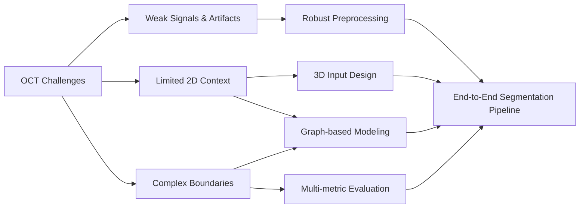
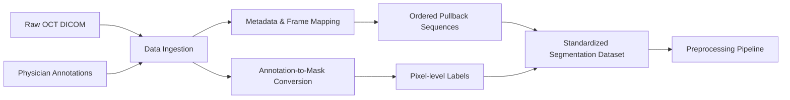
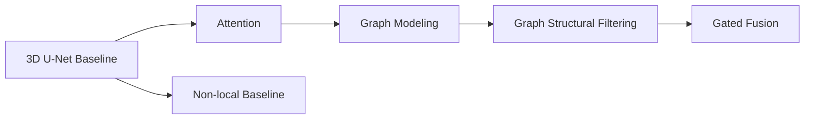
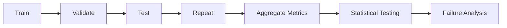

# 3D Deep Learning — Medical AI Image Segmentation

**Role:** ML/AI Engineer — Image segmentation with 3D deep learning and graph-based feature modeling.  
**When:** Jan. 2025 – Jun. 2026 · **Location:** Taipei, Taiwan

> **Disclaimer:** This portfolio presents sanitized project descriptions, aggregated research results, and publication-safe examples.  
> Raw clinical data, identifiable patient information, restricted code, and confidential research materials are not included.

---

## Project at a Glance

| Workstream | Problem | What I Built | Outcome | Key Skills |
|---|---|---|---|---|
| **1. Problem Definition** | Coronary OCT calcification is difficult to segment because of weak signals, artifacts, limited 2D context, and complex lesion boundaries | Translated imaging failure modes into clear requirements for **robustness, wider spatial context, and boundary quality** | Established the technical direction for the full ML pipeline | Problem Framing, Medical Imaging, Segmentation |
| **2. Data Preparation** | Raw clinical OCT scans, metadata, and physician annotations were not directly usable for model training | Built a structured workflow to ingest **34,954 frames**, convert clinical annotations into pixel-level masks, and preserve pullback sequence information | Created a standardized segmentation dataset linking images, labels, metadata, and frame order | Data Engineering, DICOM, Annotation Processing, Dataset Design |
| **3. Preprocessing Pipeline** | Standardized OCT frames still contained imaging noise, artifacts, signal loss, and limited longitudinal context | Built a domain-specific pipeline for **lumen noise removal, polar transformation, guidewire-shadow handling, signal enhancement, augmentation, and 3D VoI construction** | Converted raw **704×704 OCT frames into 256×256×8 model-ready 3D volumes** | Image Processing, MATLAB, Data Augmentation, 3D Data Pipeline |
| **4. Model Design** | Standard 3D CNNs mainly capture local patterns and may miss wider structural relationships | Developed and compared **3D U-Net, attention, GCN, graph structural filtering, gated fusion, and non-local** architectures | Identified **GSF_GAP** as the strongest overall model with mean **3D Dice 0.834** | Deep Learning, 3D CNN, GNN, Architecture Design |
| **5. Evaluation & Results** | Model improvements needed to be validated across full vessels and repeated experiments rather than individual VoIs or one favorable split | Reconstructed overlapping VoI predictions into full-vessel masks and evaluated models using **Dice, Precision, Recall, IoU, and statistical testing** | Achieved best mean **Dice 0.834** and **IoU 0.703**, while identifying precision–recall trade-offs across architectures | Experiment Design, Statistical Testing, Model Evaluation |

---

# Project Details

## P1 — Problem Definition

**Problem**  
Coronary calcification is difficult to segment in OCT because lesion boundaries can be unclear, deeper tissue has weaker signals, imaging artifacts can hide local structures, and calcified plaques vary greatly in shape and size.

**Solution**  
Defined the task as a **3D medical image segmentation problem** so the model could use both each OCT frame and nearby frames. This led to three main design goals: handle weak-signal regions better, capture wider spatial context, and improve boundary segmentation.

**Technical Highlights**
- **Translated real OCT failure modes into concrete model requirements:** robustness to weak signals and artifacts, stronger spatial-context modeling, and accurate boundary segmentation.
- **Moved beyond frame-by-frame segmentation by designing a 3D input setup**, allowing the model to learn lesion continuity across neighboring OCT slices.
- **Built the technical roadmap around these constraints**, connecting preprocessing, 3D volume construction, graph-based feature modeling, and evaluation into one end-to-end segmentation workflow.

**Impact**
- **Established a clear technical direction for the full ML pipeline**, turning clinical imaging challenges into specific decisions for preprocessing, 3D input design, graph-based modeling, and evaluation.

**Architecture / Workflow**

[Deep Dive →](docs/01_problem.md)

---

## P2 — Data Preparation

**Problem Snapshot**

| Challenge | Why It Matters |
|---|---|
| **Raw clinical data** | 34,954 OCT frames came from 138 patients and 192 pullbacks, with separate image, metadata, and annotation sources |
| **Clinical annotations** | Physician-defined coordinates were not directly usable as segmentation masks |
| **Sequential structure** | Frame order within each pullback had to be preserved for later 3D modeling |

**Engineering Response**

| Decision | What I Built |
|---|---|
| **Structured ingestion** | Read OCT DICOM images and metadata and linked them by patient, pullback, and frame |
| **Label construction** | Converted two-physician consensus annotations into pixel-level segmentation masks |
| **Sequence preservation** | Maintained frame order and image-mask alignment to create standardized OCT sequences |

**Technical Highlights**
- Processed **34,954 OCT frames from 138 patients and 192 pullbacks**, including **26,648 calcified** and **8,306 non-calcified frames**.
- Preserved **frame order and pullback continuity** using OCT metadata, keeping the longitudinal structure required for later 3D modeling.
- Standardized image-mask mapping and geometry across the dataset to create a consistent interface for the preprocessing pipeline.

**Impact**
- **Established a structured, model-ready OCT dataset**, providing a reliable foundation for downstream preprocessing and 3D model development.

**Architecture / Workflow**

[Deep Dive →](docs/02_data.md)

---

## P3 — Preprocessing Pipeline

**Problem Snapshot**

| Challenge | Why It Matters |
|---|---|
| **Imaging noise & artifacts** | Lumen-region noise and guidewire shadows could introduce misleading features |
| **Weak deep-tissue signals** | Calcification farther from the lumen can have lower contrast and unclear boundaries |
| **OCT geometry** | Raw Cartesian images do not naturally represent the radial vessel-wall structure |
| **Limited 2D context** | A single frame cannot capture lesion continuity along the vessel |

**Engineering Response**

| Decision | What I Built |
|---|---|
| **Clean the signal** | Removed lumen noise and guidewire-shadow regions |
| **Normalize the geometry** | Converted Cartesian OCT frames to a 256×256 polar representation |
| **Strengthen useful features** | Applied depth-aware enhancement and OCT-specific augmentation |
| **Add longitudinal context** | Built overlapping 8-slice 3D VoIs with stride 3 |

**Technical Highlights**
- Combined **U-Net-based lumen segmentation and guidewire-shadow removal** to reduce OCT-specific imaging noise before model training.
- Transformed raw OCT frames from **Cartesian to 256×256 polar coordinates**, aligning the representation with the radial structure of the vessel wall.
- Applied **depth-aware signal enhancement and center-shift augmentation** to strengthen weak deep-tissue features and increase input variation.
- Constructed overlapping **8-slice 3D VoIs with stride 3**, producing **256×256×8×1 inputs** that preserve longitudinal lesion context.

**Impact**
- **Built a robust 3D input pipeline for volumetric segmentation**, reducing OCT-specific noise while preserving vessel structure and longitudinal lesion context.

**Architecture / Workflow**

```mermaid
flowchart LR
    A["Standardized OCT Sequences"]

    subgraph S1["1. Clean"]
        B["Lumen Noise Removal"]
        C["Guidewire Shadow Removal"]
    end

    subgraph S2["2. Normalize"]
        D["Cartesian → Polar"]
        E["Resize to 256×256"]
    end

    subgraph S3["3. Enhance"]
        F["Depth-aware Signal Enhancement"]
        G["Center-shift Augmentation"]
    end

    subgraph S4["4. Build 3D Context"]
        H["8-slice Sliding Window"]
        I["Stride = 3"]
    end

    J["256×256×8×1 Model Input"]

    A --> B
    B --> C
    C --> D
    D --> E
    E --> F
    F --> G
    G --> H
    H --> I
    I --> J
```

[Deep Dive →](docs/03_pipeline.md)

---

## P4 — Model Design

**Problem**  
_TODO_

**Solution**  
_TODO_

**Technical Highlights**
- _TODO_
- _TODO_
- _TODO_

**Impact**
- _TODO_

**Architecture / Workflow**

[Deep Dive →](docs/04_model_design.md)

---

## P5 — Experiment & Results

**Problem**  
_TODO_

**Solution**  
_TODO_

**Technical Highlights**
- _TODO_
- _TODO_
- _TODO_

**Impact**
- _TODO_

**Architecture / Workflow**

[Deep Dive →](docs/05_experiments_results.md)

---

## Key Engineering Takeaways

_TODO_

---

## Tech Stack

| Area | Technologies |
|---|---|
| Programming | _TODO_ |
| Deep Learning | _TODO_ |
| Graph Learning | _TODO_ |
| Image Processing | _TODO_ |
| Experimentation | _TODO_ |
| Visualization | _TODO_ |
| Compute / Engineering | _TODO_ |

---

## Context / Disclaimer

**Project Context**  
_TODO_

**Data Privacy**  
_TODO_

**Repository Scope**  
_TODO_
