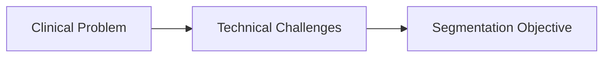
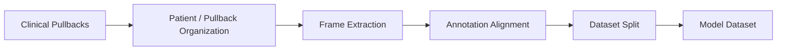
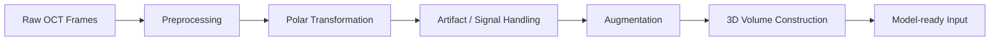
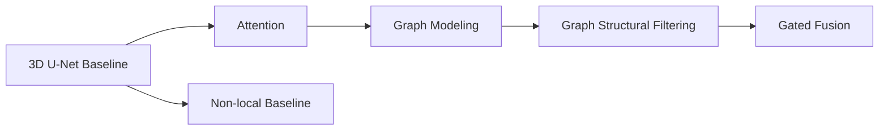
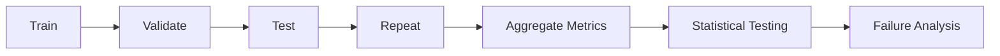

# 3D Deep Learning — Medical AI Image Segmentation

**Role:** ML/AI Engineer — Image segmentation with 3D deep learning and graph-based feature modeling.  
**When:** Jan. 2025 – Jun. 2026 · **Location:** Taipei, Taiwan

> **Disclaimer:** This portfolio presents sanitized project descriptions, aggregated research results, and publication-safe examples.  
> Raw clinical data, identifiable patient information, restricted code, and confidential research materials are not included.

---

## Project at a Glance

| Module | Problem | What I Built | Result / Output | Key Skills |
|---|---|---|---|---|
| **1. Problem** | Coronary OCT calcification has weak boundaries, low contrast, artifacts, and highly variable morphology | Defined a 3D segmentation task focused on robust calcified-plaque delineation across challenging lesion patterns | Clear modeling objectives and failure modes for downstream system design | Problem Framing, Medical Imaging, Segmentation |
| **2. Data** | Large-scale clinical OCT data were heterogeneous and not directly model-ready | Organized **138 patients, 192 pullbacks, and 34,954 frames** into a structured vessel-level dataset | Reproducible dataset organization for controlled training, validation, and testing | Data Processing, Dataset Design, Clinical Imaging |
| **3. Pipeline** | Raw 2D OCT frames required anatomical transformation, artifact handling, and longitudinal context | Built preprocessing, polar transformation, enhancement, augmentation, and **8-slice 3D volume** construction | Converted **704×704 raw frames → 256×256×8 model inputs** | Python, Image Processing, 3D Data Pipeline |
| **4. Model Design** | Standard 3D CNNs primarily capture local context and may miss long-range structural relationships | Developed and compared **3D U-Net, attention, GCN, GSF, gated GSF, and non-local** architectures | **GSF_GAP achieved the best mean 3D Dice of 0.834** | Deep Learning, 3D CNN, GNN, Model Architecture |
| **5. Experiment & Results** | Model gains needed to be validated beyond a single split or metric | Designed repeated train/validation/test experiments with multi-metric evaluation and statistical testing | Best mean **Dice 0.834** and **IoU 0.703**, with precision–recall trade-offs quantified across models | Experiment Design, Statistical Testing, Model Evaluation |

---

# Project Details

## P1 — Problem

**Problem**  
_TODO_

**Solution**  
_TODO_

**Technical Highlights**
- _TODO_
- _TODO_
- _TODO_

**Impact**
- _TODO_

**Architecture / Workflow**

[Deep Dive →](docs/01_problem.md)

---

## P2 — Data

**Problem**  
_TODO_

**Solution**  
_TODO_

**Technical Highlights**
- _TODO_
- _TODO_
- _TODO_

**Impact**
- _TODO_

**Architecture / Workflow**

[Deep Dive →](docs/02_data.md)

---

## P3 — Pipeline

**Problem**  
_TODO_

**Solution**  
_TODO_

**Technical Highlights**
- _TODO_
- _TODO_
- _TODO_

**Impact**
- _TODO_

**Architecture / Workflow**

[Deep Dive →](docs/03_pipeline.md)

---

## P4 — Model Design

**Problem**  
_TODO_

**Solution**  
_TODO_

**Technical Highlights**
- _TODO_
- _TODO_
- _TODO_

**Impact**
- _TODO_

**Architecture / Workflow**

[Deep Dive →](docs/04_model_design.md)

---

## P5 — Experiment & Results

**Problem**  
_TODO_

**Solution**  
_TODO_

**Technical Highlights**
- _TODO_
- _TODO_
- _TODO_

**Impact**
- _TODO_

**Architecture / Workflow**

[Deep Dive →](docs/05_experiments_results.md)

---

## Key Engineering Takeaways

_TODO_

---

## Tech Stack

| Area | Technologies |
|---|---|
| Programming | _TODO_ |
| Deep Learning | _TODO_ |
| Graph Learning | _TODO_ |
| Image Processing | _TODO_ |
| Experimentation | _TODO_ |
| Visualization | _TODO_ |
| Compute / Engineering | _TODO_ |

---

## Context / Disclaimer

**Project Context**  
_TODO_

**Data Privacy**  
_TODO_

**Repository Scope**  
_TODO_
