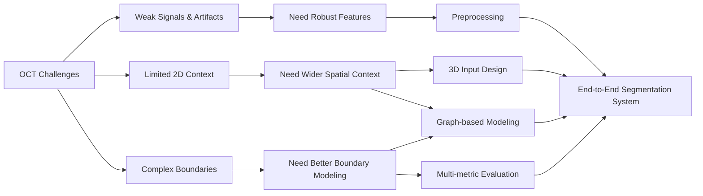

# 01. Problem Definition

## 1. Task Definition

This project focuses on **3D segmentation of coronary calcification in intravascular optical coherence tomography (IVOCT)**.

The task is to identify calcified regions in each OCT frame while using information from neighboring frames to improve segmentation consistency.

Instead of treating every frame as an independent 2D image, I formulated the problem as **3D medical image segmentation**, allowing the model to learn both:

- **cross-sectional features** within each OCT frame, and
- **lesion continuity** across neighboring frames.

The goal was not simply to maximize a single segmentation score, but to build a system that remains reliable across difficult imaging conditions and different lesion patterns.

---

## 2. Why the Problem Is Hard

The segmentation challenge can be grouped into two main areas.

### A. Image and Lesion Challenges

**Weak and unclear boundaries**  
Calcified regions do not always have sharp or complete boundaries. Some lesions gradually blend into surrounding tissue, increasing the risk of both under-segmentation and over-segmentation.

**Weak deep-tissue signals**  
OCT signal strength decreases with tissue depth. Deeper calcification can therefore appear darker and less distinct than structures closer to the lumen.

**Imaging artifacts**  
Guidewire shadows and other artifacts can hide vessel-wall information or create low-signal regions that may confuse the model.

**Large variation in lesion shape and size**  
Calcification can appear as thin arcs, thick plaques, long continuous regions, fragmented lesions, or near-circumferential structures.

### B. Context Limitation

**A single 2D frame provides limited context**  
One OCT frame shows only one cross-section of the vessel. However, calcified lesions often continue across multiple neighboring frames.

Processing each frame independently can therefore lose useful information about lesion continuity and structure.

---

## 3. From Challenges to Engineering Requirements

The key step was to translate these imaging challenges into clear engineering requirements.

| Challenge | Engineering Requirement |
|---|---|
| Weak deep-tissue signals | Improve robustness to weak local features |
| Imaging artifacts | Reduce sensitivity to noisy or misleading regions |
| Limited 2D context | Capture information across neighboring OCT frames |
| Large variation in lesion shape and size | Model wider spatial relationships |
| Unclear lesion boundaries | Evaluate both overlap quality and error balance |

This mapping defined what the ML system needed to solve before selecting specific architectures.

---

## 4. Design Goals

Based on these requirements, I defined three design goals for the project.

### 1. Robustness

The model should remain reliable when image quality is poor, signals are weak, or artifacts are present.

### 2. Wider Spatial Context

The model should use information beyond a single local image region and beyond a single OCT frame.

### 3. Boundary Quality

The model should preserve difficult lesion boundaries across thin, thick, irregular, and near-circumferential calcification.

These goals guided the later preprocessing pipeline, 3D input design, and graph-based model development.

---

## 5. Problem-to-System Mapping

The overall logic is:

**OCT challenges → engineering requirements → technical design directions → end-to-end segmentation system**

---

## 6. Key Technical Questions & Answers

| Technical Question | Short Answer | Evidence |
|---|---|---|
| **Can 3D context improve segmentation compared with frame-by-frame processing?** | **Yes.** Using neighboring OCT slices provides longitudinal context that is not available from isolated 2D frames and became the basis of the 3D input design. | [Pipeline Deep Dive →](03_pipeline.md) |
| **Can attention or graph-based models capture useful long-range spatial relationships?** | **Partially.** Graph-based variants improved overall segmentation quality more consistently than attention-only or non-local alternatives. | [Model Design Deep Dive →](04_model_design.md) |
| **Can graph filtering reduce noisy spatial relationships while preserving useful structure?** | **Yes.** GSF-based models produced the strongest overall results, with GSF_GAP achieving the best mean 3D Dice. | [Model Design Deep Dive →](04_model_design.md) |
| **Are model improvements consistent across repeated experiments and multiple metrics?** | **Yes, but with trade-offs.** The best-performing models showed stronger Dice/IoU while Precision and Recall varied across architectures. | [Experiments & Results →](05_experiments_results.md) |
| **Where does the strongest model still fail?** | **Mainly in difficult boundary cases and weak-signal regions.** These failure modes are analyzed qualitatively rather than hidden behind aggregate metrics. | [Experiments & Results →](05_experiments_results.md) |

---

## 7. Success Criteria

A stronger model should not be judged by a single metric alone.

I therefore defined success across four dimensions:

- **Segmentation accuracy:** improve Dice and IoU.
- **Error balance:** maintain a reasonable balance between Precision and Recall.
- **Consistency:** show stable performance across repeated experiments rather than one favorable split.
- **Qualitative robustness:** perform well across different lesion shapes and difficult imaging conditions.

These criteria became the basis for the final evaluation framework.
