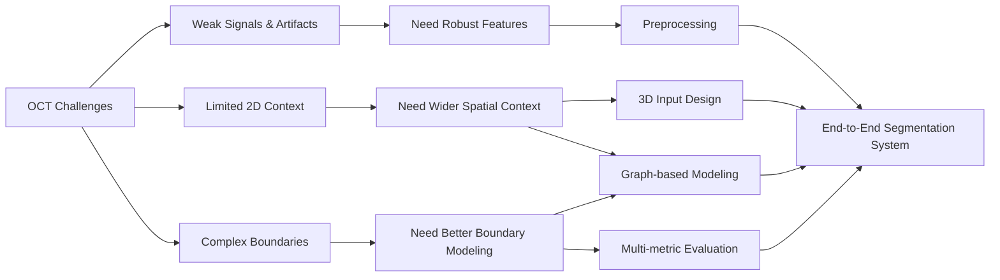

# P1 — Problem Definition

[← Back to README](../README.md#p1--problem-definition)

> **Goal:** Translate imaging failure modes into engineering requirements before choosing preprocessing and model strategies.

## 1. Task Definition

This project focuses on **3D segmentation of coronary calcification in intravascular optical coherence tomography (IVOCT)**.

The task is to identify calcified regions in each OCT frame while using information from neighboring frames to improve segmentation consistency.

Instead of treating every frame as an independent 2D image, I formulated the problem as **3D medical image segmentation**, allowing the model to learn both:

- **cross-sectional features** within each OCT frame, and
- **lesion continuity** across neighboring frames.

The goal was not simply to maximize a single segmentation score, but to build a system that remains reliable across difficult imaging conditions and different lesion patterns.

---

## 2. Key Segmentation Challenges

The main challenges fall into two categories: **image / lesion complexity** and **limited spatial context**.

### A. Image & Lesion Complexity

- **Unclear boundaries**  
  Calcified regions may have weak or incomplete edges, increasing the risk of under-segmentation and over-segmentation.

- **Weak deep-tissue signals**  
  OCT signal strength decreases with tissue depth, making deeper calcification harder to distinguish.

- **Imaging artifacts**  
  Guidewire shadows and other artifacts can hide vessel-wall information or create misleading low-signal regions.

- **Large variation in lesion morphology**  
  Calcification can appear as thin arcs, thick plaques, fragmented regions, long continuous lesions, or near-circumferential structures.

### B. Limited Spatial Context

- **A single frame captures only one vessel cross-section**  
  Calcified lesions often continue across neighboring frames, so frame-by-frame processing can miss useful longitudinal information.

### Key Takeaway

These challenges suggest that a strong solution needs to be **robust to noisy signals, use information across multiple frames, and handle complex lesion boundaries**.

---

## 3. From Challenges to Engineering Requirements

The key step was to translate these imaging challenges into clear engineering requirements.

| Challenge | Engineering Requirement |
|---|---|
| Weak deep-tissue signals | Improve robustness to weak local features |
| Imaging artifacts | Reduce sensitivity to noisy or misleading regions |
| Limited 2D context | Capture information across neighboring OCT frames |
| Large variation in lesion shape and size | Model wider spatial relationships |
| Unclear lesion boundaries | Evaluate both overlap quality and error balance |

This mapping defined what the ML system needed to solve before selecting specific architectures.

---

## 4. Design Goals

Based on these requirements, I defined three design goals for the project.

### 1. Robustness

The model should remain reliable when image quality is poor, signals are weak, or artifacts are present.

### 2. Wider Spatial Context

The model should use information beyond a single local image region and beyond a single OCT frame.

### 3. Boundary Quality

The model should preserve difficult lesion boundaries across thin, thick, irregular, and near-circumferential calcification.

These goals guided the later preprocessing pipeline, 3D input design, and graph-based model development.

---

## 5. Problem-to-System Mapping

The overall logic is:

**OCT challenges → engineering requirements → technical design directions → end-to-end segmentation system**

---

## 6. Validation Questions

| Design Question | Why It Matters | Validated In |
|---|---|---|
| **Why use 3D context instead of frame-by-frame input?** | Preserve longitudinal information across neighboring slices | [P3 — Preprocessing Pipeline](03_pipeline.md) |
| **Does graph message passing add value beyond the 3D CNN backbone?** | Test whether explicit long-range relations improve the representation | [P4 — Model Design](04_model_design.md) · [P5 — Validation](05_experiments_results.md) |
| **Does Graph Structural Filtering add value before GraphConv?** | Isolate the effect of graph-frequency feature refinement | [P4 — Model Design](04_model_design.md) · [P5 — Validation](05_experiments_results.md) |
| **Are gains stable across repeated tests and multiple metrics?** | Avoid selecting a model from one favorable split or one score | [P5 — Model Validation & Results](05_experiments_results.md) |
| **Where does the system still fail?** | Separate model improvements from remaining data-quality limitations | [P5 — Failure Analysis](05_experiments_results.md#8-failure-analysis) |
---

## 7. Success Criteria

A stronger model should not be judged by a single metric alone.

I therefore defined success across four dimensions:

- **Segmentation accuracy:** improve Dice and IoU.
- **Error balance:** maintain a reasonable balance between Precision and Recall.
- **Consistency:** show stable performance across repeated experiments rather than one favorable split.
- **Qualitative robustness:** perform well across different lesion shapes and difficult imaging conditions.

These criteria became the basis for the final evaluation framework.

---

## Key Takeaways

- The segmentation problem was translated into three requirements: **robustness, wider spatial context, and boundary quality**.
- Those requirements directly shaped the later **preprocessing, 3D input, graph-modeling, and evaluation** decisions.
- The project was structured around testable design questions rather than selecting architectures first and justifying them afterward.

---

## Next

Turn the problem requirements into a reliable dataset with aligned images, labels, metadata, and frame order:

**[P2 — Data Preparation →](02_data.md)**
