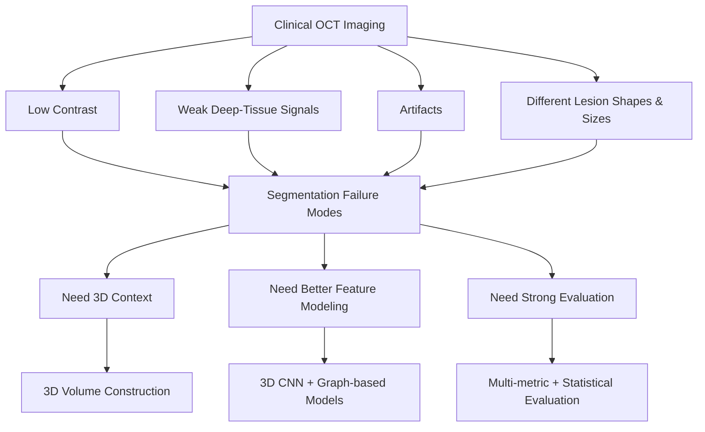

# 01. Problem Definition

## Objective

This project focuses on **3D segmentation of coronary calcification in intravascular optical coherence tomography (IVOCT)**.

The goal was to build a segmentation system that could work reliably across difficult OCT cases, not just improve one overlap metric.

---

## Why This Problem Is Difficult

### 1. Unclear lesion boundaries

Calcified regions do not always have sharp and complete boundaries. Some lesions blend into nearby tissue, which makes pixel-level segmentation difficult.

### 2. Weaker signals in deeper tissue

OCT signal strength decreases with tissue depth. This means deeper calcification can be much harder to detect than structures closer to the lumen.

### 3. Imaging artifacts

Guidewire shadows and other artifacts can hide vessel-wall information and create low-signal regions that confuse the model.

### 4. Large differences in lesion shape and size

Calcification can appear as thin arcs, thick plaques, long continuous regions, or near-circumferential structures. The model therefore needs to handle many different shapes and sizes.

### 5. Limited information in a single 2D frame

One OCT frame only shows one cross-section of the vessel. Nearby frames provide useful information about how a lesion continues along the vessel, which is why this project uses 3D input.

---

## Engineering Setup

These challenges led to three main design goals:

1. **Handle weak-signal regions more reliably.**
2. **Capture wider spatial context instead of relying only on local convolution.**
3. **Improve segmentation of difficult lesion boundaries.**

These goals guided the later preprocessing pipeline, 3D U-Net baseline, graph-based models, and evaluation strategy.

---

## Problem-to-System Mapping

---

## Main Technical Questions

This problem definition led to the main questions explored in the project:

- Can 3D context improve segmentation compared with using individual 2D frames?
- Can attention or graph-based models capture useful long-range structure?
- Can graph filtering reduce noisy spatial relationships?
- Are the model improvements consistent across repeated experiments?
- Where does the best model still fail?

These questions define the rest of the repository.
