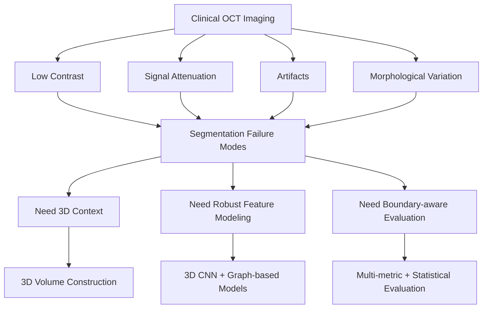

# 01. Problem Definition

## Objective

The project focuses on **3D segmentation of coronary calcification in intravascular optical coherence tomography (IVOCT)**.

The engineering goal was not only to improve overlap metrics, but to design a segmentation system that remains reliable across difficult imaging conditions where lesion appearance, tissue depth, and local artifacts can substantially change the visual signal.

---

## Why This Problem Is Difficult

### 1. Low-contrast and incomplete boundaries

Calcified regions do not always present a sharp, continuous boundary. Deep or weakly contrasted lesions can blend into surrounding tissue, making pixel-level delineation difficult even when the lesion is visually present.

### 2. Signal attenuation with tissue depth

OCT signal quality decreases in deeper tissue. This creates a depth-dependent segmentation challenge in which the same anatomical structure can have very different visibility depending on its location.

### 3. Imaging artifacts

Artifacts such as guidewire shadows may obscure vessel-wall information and create low-signal regions that can be confused with pathological structures.

### 4. Large morphological variation

Calcification can appear as thin arcs, thick plaques, long continuous structures, or near-circumferential regions. A model therefore needs to handle substantial variation in size, shape, and spatial extent.

### 5. Limited context in isolated 2D frames

A single OCT frame captures only one cross-section of the vessel. Adjacent frames contain useful longitudinal information about lesion continuity and structure, motivating a 3D formulation.

---

## Engineering Formulation

Based on these challenges, the task was formulated as a **3D volumetric segmentation problem**.

The problem definition translated into three design requirements:

1. **Robust feature extraction** for low-contrast and attenuated regions.
2. **Broader spatial-context modeling** beyond purely local convolutional features.
3. **Stable boundary delineation** across heterogeneous lesion morphologies.

These requirements directly informed the later preprocessing pipeline, 3D U-Net baseline, graph-based model variants, and evaluation strategy.

---

## Problem-to-System Mapping

---

## Design Questions

This problem definition led to the main technical questions explored in the project:

- Can 3D context improve segmentation compared with frame-level reasoning?
- Can attention or graph-based modeling capture useful long-range structure?
- Can graph-domain filtering reduce noisy spatial relationships?
- Which model improvements remain consistent across repeated experiments?
- Where do stronger models still fail, and what do those failures reveal about the system?

These questions define the rest of the repository.
