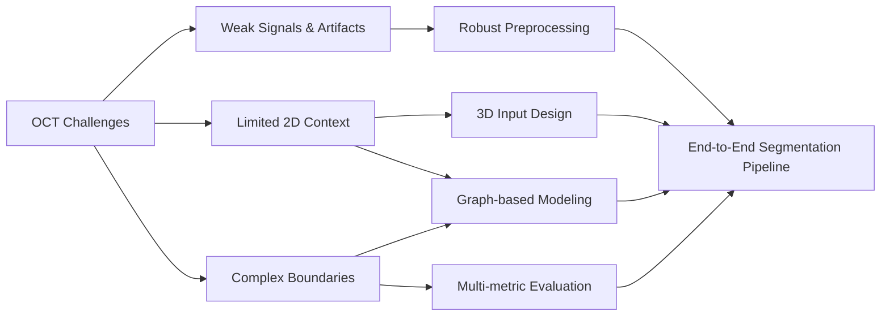

# 01. Problem Definition

## Task Definition

This project focuses on **3D segmentation of coronary calcification in intravascular optical coherence tomography (IVOCT)**.

The task is to predict the calcified region for each OCT frame while using information from neighboring frames to improve segmentation consistency and robustness.

Instead of treating the problem as isolated 2D image segmentation, I defined it as a **3D volumetric segmentation task** so the model could learn both:

- **cross-sectional appearance** within each OCT frame, and
- **longitudinal continuity** across adjacent frames.

The goal was not simply to improve one segmentation metric. The broader objective was to build a model that performs reliably across difficult lesion patterns, weak-signal regions, and imaging artifacts.

---

## Why This Problem Is Difficult

### 1. Unclear lesion boundaries

Calcified regions do not always have sharp and complete boundaries.

Some lesions gradually blend into nearby tissue, while others contain partially visible or broken edges. This makes pixel-level labeling difficult and increases the risk of both under-segmentation and over-segmentation.

### 2. Weaker signals in deeper tissue

OCT signal strength decreases with tissue depth.

As a result, deeper calcification can appear darker and less distinct than structures closer to the lumen. A model that relies too heavily on local intensity patterns may therefore miss deep lesions.

### 3. Imaging artifacts

Guidewire shadows and other imaging artifacts can hide vessel-wall information or create low-signal regions that resemble abnormal tissue.

This introduces noise that can confuse feature extraction and boundary prediction.

### 4. Large differences in lesion shape and size

Calcification can appear in very different forms, including:

- thin arcs,
- thick plaques,
- long continuous regions,
- fragmented lesions,
- near-circumferential structures.

A robust model therefore needs to handle large differences in lesion size, shape, thickness, and spatial extent.

### 5. Limited information in a single 2D frame

A single OCT frame only captures one cross-section of the vessel.

However, calcified lesions often continue across multiple neighboring frames. This means useful structural information is lost when each frame is processed independently.

This observation motivated the use of **3D input volumes**.

---

## From Imaging Challenges to Engineering Requirements

Rather than treating these challenges only as clinical background, I translated them into concrete design requirements for the ML system.

| OCT Challenge | Engineering Requirement | Design Direction |
|---|---|---|
| Weak deep-tissue signals | Improve robustness to weak local features | Signal-aware preprocessing and stronger feature extraction |
| Imaging artifacts | Reduce sensitivity to noisy or misleading regions | Artifact handling and robust representation learning |
| Limited 2D context | Capture lesion continuity across frames | 3D volume construction and 3D convolution |
| Complex lesion shapes | Model wider spatial relationships | Attention and graph-based feature modeling |
| Unclear boundaries | Evaluate more than overall overlap | Multi-metric evaluation and qualitative error analysis |

This mapping became the technical roadmap for the rest of the project.

---

## Core Design Goals

Based on the problem analysis, I defined three main design goals.

### 1. Improve robustness to weak and noisy signals

The system should remain useful when lesion contrast is low or local image quality is poor.

This requirement influenced both the preprocessing pipeline and later model design.

### 2. Capture wider spatial context

Local convolution is effective for nearby image patterns, but complex calcification may require information from a wider region or from neighboring OCT slices.

This motivated:

- 3D input construction,
- attention-based modeling,
- graph-based modeling,
- graph structural filtering,
- non-local comparison.

### 3. Improve boundary segmentation across different lesion patterns

The model should work across thin, thick, long, irregular, and near-circumferential lesions.

This made boundary quality and failure-case analysis important parts of model evaluation.

---

## Problem-to-System Mapping

---

## Main Technical Questions

The problem definition led to five questions that guided the project:

1. **Can 3D context improve segmentation compared with frame-by-frame processing?**
2. **Can attention or graph-based models capture useful long-range structure?**
3. **Can graph filtering reduce noisy spatial relationships while keeping useful structural information?**
4. **Are model improvements consistent across repeated experiments and multiple evaluation metrics?**
5. **Where does the strongest model still fail, and what do those failures reveal about the system?**

These questions directly connect the problem definition to the later data pipeline, model design, and evaluation strategy.

---

## Success Criteria

A useful solution should not be judged by a single metric alone.

I therefore defined success in four ways:

- **Segmentation accuracy:** improve overlap-based metrics such as Dice and IoU.
- **Precision-recall balance:** avoid improving one type of error while significantly worsening another.
- **Consistency:** show stable improvements across repeated experiments rather than one favorable split.
- **Robustness:** perform well across different lesion shapes and difficult imaging conditions.

These criteria became the basis for the final evaluation framework.

---

## Scope

This project focuses on the engineering and modeling workflow for coronary OCT calcification segmentation.

The following topics are handled in later sections:

- dataset organization and preparation,
- preprocessing and 3D volume construction,
- model architecture design,
- graph structural filtering,
- repeated experiments,
- statistical testing,
- qualitative and failure-case analysis.

The raw clinical data are not included in this repository.
