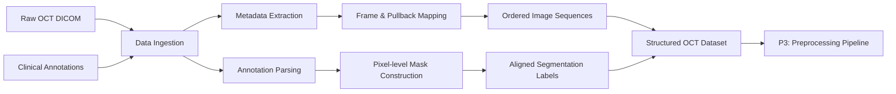

# 02. Data Preparation

## 1. What This Stage Solves

Before model development, the raw clinical OCT data had to be converted into a consistent segmentation dataset.

The main task was to connect four pieces of information correctly:

- **OCT images**
- **clinical annotations**
- **image metadata**
- **frame order within each pullback**

The output of this stage is an **ordered and aligned image-mask dataset** that can be passed into the image preprocessing and 3D volume construction pipeline.

---

## 2. Dataset Snapshot

The dataset was collected using the **Abbott OPTIS OCT imaging system** and contains coronary OCT pullbacks from 138 patients.

| Dataset Item | Scale |
|---|---:|
| Patients | **138** |
| OCT pullbacks | **192** |
| Calcified segments | **436** |
| Total OCT frames | **34,954** |
| Calcified frames | **26,648** |
| Non-calcified frames | **8,306** |
| Original image size | **704 × 704** |

Each pullback contains both calcified and non-calcified frames.

Calcified regions were labeled based on the **consensus of two physicians**, providing the reference annotations used for segmentation model development.

---

## 3. Key Data Preparation Challenges

The data preparation problem can be grouped into three areas.

### A. Multiple Data Sources

The segmentation dataset was not stored as a simple image-mask folder.

Each OCT frame had to be connected with:

- its image data,
- DICOM metadata,
- annotation information,
- pullback identity,
- original frame position.

A mismatch between any of these components could create incorrect image-label pairs.

### B. Clinical Annotations Were Not Model-ready Labels

The original annotation records described calcified regions using spatial coordinates rather than ready-to-use binary masks.

These annotations therefore had to be converted into **pixel-level segmentation labels** while keeping the geometry aligned with the corresponding OCT image.

### C. OCT Frames Have Sequential Structure

Frames from the same OCT pullback are ordered along the vessel.

This order is essential because the later 3D model uses neighboring frames as one input volume.

Treating the dataset as a collection of independent images would remove this longitudinal information.

### Key Takeaway

The goal of P2 was not only to collect images, but to preserve the **image-label relationship and vessel sequence structure** required by the later 3D pipeline.

---

## 4. Data Preparation Workflow



The workflow separates **data organization** from **image transformation**.

P2 determines *what each sample is and where it belongs*.  
P3 determines *how the image itself should be transformed before training*.

---

## 5. Image, Metadata & Annotation Alignment

### DICOM Ingestion

The data pipeline reads both the OCT image and its associated DICOM metadata.

Key metadata fields are used to maintain the original scan structure, including:

- **InstanceNumber** for frame ordering,
- **PixelSpacing** for spatial alignment,
- pullback-level organization.

This allows the pipeline to reconstruct the original sequence rather than relying on file names alone.

### Annotation-to-Mask Construction

Clinical annotation coordinates are mapped to the corresponding OCT image and converted into pixel-level segmentation masks.

The resulting structure is:

```text
OCT Frame
   │
   ├── Image
   ├── Calcification Mask
   ├── Frame Index
   └── Pullback Information
```

This image-mask alignment becomes the ground-truth representation used throughout model development.

---

## 6. Preserving Pullback Continuity

Frame ordering is especially important for this project because the final model does not process isolated images.

The data pipeline therefore preserves the original OCT sequence using frame metadata and checks the continuity of neighboring frames.

Conceptually:

```text
Pullback
│
├── Frame 001
├── Frame 002
├── Frame 003
├── ...
└── Frame T
```

This ordered structure becomes the input for the sliding-window VoI construction in P3.

### Why This Matters

Without preserved frame order:

- neighboring slices could be mixed incorrectly,
- 3D volumes would no longer represent true vessel continuity,
- longitudinal lesion information would be unreliable.

Sequence preservation is therefore a **data requirement**, not only a preprocessing detail.

---

## 7. Output Data Contract

At the end of P2, each OCT sequence contains the information required by the next stage:

| Output | Purpose |
|---|---|
| **OCT image** | Input image for preprocessing |
| **Segmentation mask** | Ground-truth label |
| **Frame index** | Preserves longitudinal position |
| **Pullback identity** | Keeps frames grouped by vessel scan |
| **Ordered sequence** | Enables later 3D VoI construction |

### P2 Output

**Ordered, aligned OCT image-mask sequences**

↓

### Consumed by P3

**Domain-specific image preprocessing and 3D volume construction**

---

## 8. Engineering Takeaway

The main engineering value of this stage was establishing a reliable interface between **raw clinical data** and the later **computer-vision pipeline**.

By preserving image-label alignment, metadata, and sequence order, the same structured dataset could be reused consistently across preprocessing and model experiments.
