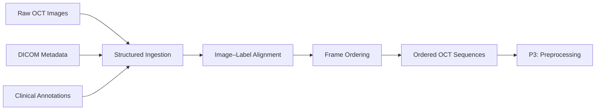

# 02. Data Preparation

> **Goal:** Turn raw clinical OCT images, metadata, and physician annotations into an ordered and aligned segmentation dataset for downstream 3D modeling.

---

## 1. Dataset at a Glance

| Dataset | Scale |
|---|---:|
| Patients | **138** |
| OCT pullbacks | **192** |
| Calcified segments | **436** |
| Total frames | **34,954** |
| Calcified frames | **26,648** |
| Non-calcified frames | **8,306** |
| Original resolution | **704 × 704** |
| Imaging system | **Abbott OPTIS OCT** |

Calcified regions were labeled based on the **consensus of two physicians**.

### Data Structure

```text
Patient
└── OCT Pullback
    └── Ordered Frames
        ├── OCT Image
        ├── Metadata
        └── Calcification Annotation
```

The key challenge was not simply handling 34,954 images — it was keeping **image, label, metadata, and frame sequence correctly aligned**.

---

## 2. Key Data Challenges

| Challenge | Why It Matters |
|---|---|
| **Multiple data sources** | Images, metadata, and annotations had to refer to the same OCT frame |
| **Annotation format** | Clinical coordinate annotations had to become pixel-level segmentation masks |
| **Sequential structure** | Frame order had to be preserved because later 3D inputs use neighboring slices |

### Key Takeaway

The dataset could not be treated as a flat folder of independent images.

It had to preserve both:

- **spatial alignment** — image ↔ segmentation mask
- **longitudinal alignment** — frame ↔ neighboring frames in the same pullback

---

## 3. What I Built

I built a MATLAB-based data preparation workflow with three main functions.

### A. Structured Data Ingestion

- Read raw OCT images and associated DICOM metadata
- Extracted frame information such as **InstanceNumber**
- Preserved patient and pullback relationships

### B. Image–Label Alignment

- Parsed physician-defined calcification annotations
- Converted annotation regions into pixel-level segmentation masks
- Maintained consistent image-mask geometry

### C. Sequence Preservation

- Ordered frames according to their original OCT scan sequence
- Checked continuity between neighboring frames
- Prepared each pullback as an ordered sequence for later 3D volume construction

---

## 4. Data Preparation Workflow



### Before

```text
Images + Metadata + Annotation Files
```

### After

```text
Pullback
├── Frame 001 → Image + Mask
├── Frame 002 → Image + Mask
├── Frame 003 → Image + Mask
└── ...
```

This structure provides a consistent input interface for every later preprocessing and modeling experiment.

---

## 5. Output

### P2 Output

**Ordered and aligned OCT image-mask sequences**

Each frame retains:

| Information | Purpose |
|---|---|
| OCT image | Model input |
| Segmentation mask | Ground truth |
| Frame index | Longitudinal position |
| Pullback identity | Sequence grouping |

### Why It Matters

P2 establishes the **data contract** for the rest of the system.

The next stage can focus entirely on image transformation and 3D input construction without redefining the underlying dataset.

**P2: Structure the data → P3: Transform the data**

[Next: Preprocessing Pipeline →](03_pipeline.md)
