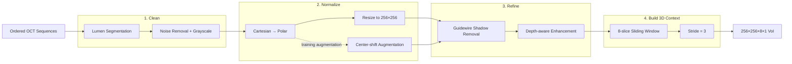

# 03. Preprocessing Pipeline

## 1. What This Stage Solves

The structured OCT dataset from P2 was still not directly suitable for 3D segmentation.

Raw OCT images contain domain-specific issues that can interfere with learning:

- noise inside the vessel lumen,
- circular vessel geometry represented in Cartesian coordinates,
- guidewire shadows,
- weak signals in deeper tissue,
- limited information in a single 2D frame.

I therefore designed the preprocessing pipeline around four objectives:

> **Clean → Normalize → Refine → Build 3D Context**

The final output is a **256 × 256 × 8 × 1 model-ready 3D Volume of Interest (VoI)**.

---

## 2. Pipeline at a Glance



Each stage addresses a different limitation of the raw OCT data.

---

# Stage 1 — Clean

## 3. Lumen Noise Removal

### Problem

Because of the OCT acquisition process, the vessel lumen may contain structures that are not useful for calcification segmentation, including:

- guidewire-related reflections,
- residual blood,
- other lumen-region noise.

These signals can become distracting features during model training.

### Approach

A **U-Net-based lumen segmentation model** was used to identify the lumen region.

The segmented lumen area was then removed from the OCT image so later models could focus more strongly on vessel-wall structures.

The original RGB image was also converted to grayscale:

[
Y = 0.299R + 0.587G + 0.114B
]

This reduces the input to a single intensity channel and lowers unnecessary computational complexity.

### Output

**Cleaned grayscale OCT frame**

---

# Stage 2 — Normalize

## 4. Cartesian-to-Polar Transformation

### Problem

OCT images are originally represented in Cartesian coordinates, while the anatomy itself is organized radially around the imaging catheter.

This means the vessel wall appears as a circular structure, which is less naturally aligned with standard convolutional operations.

### Approach

The image is resampled into **polar coordinates** using the catheter center as the transformation origin.

Conceptually:

[
x = rcos(	heta), qquad y = rsin(	heta)
]

The transformation:

- samples the vessel radially from the lumen toward deeper tissue,
- unwraps the circular vessel wall into a rectangular representation,
- keeps tissue depth aligned along a consistent image direction.

The transformed image is then resized using bilinear interpolation to:

> **256 × 256**

### Why Polar Representation Helps

After transformation:

- one axis represents the angular position around the vessel,
- the other represents tissue depth.

This creates a representation that is better aligned with the anatomical structure being segmented.

---

## 5. OCT-specific Center-shift Augmentation

### Problem

A model trained on only one polar transformation center may become overly dependent on a fixed geometric representation.

### Approach

Instead of applying generic image rotations or translations after preprocessing, augmentation is introduced directly into the OCT coordinate transformation.

Four additional centers are created around the original catheter center:

```text
(x + 10, y)
(x - 10, y)
(x, y + 10)
(x, y - 10)
```

Each center generates a different polar representation of the same OCT frame.

### Why This Design

The augmentation changes the spatial representation while preserving the underlying vessel anatomy.

This provides additional variation that is specific to OCT imaging geometry rather than relying only on generic computer-vision augmentation.

---

# Stage 3 — Refine

## 6. Guidewire Shadow Removal

### Problem

The guidewire can produce a radial low-intensity shadow that hides part of the vessel wall.

Because the shadow can resemble low-signal tissue, it may introduce misleading features during segmentation.

### Approach

Guidewire shadows are easier to detect after polar transformation.

For each polar OCT frame:

1. pixel intensities are aggregated along the relevant image direction;
2. these intensity profiles are stacked across consecutive frames;
3. the guidewire shadow appears as a **continuous low-intensity trajectory**;
4. **dynamic programming** is used to identify its boundaries;
5. the detected shadow region is removed from the OCT image.

### Why Use Consecutive Frames?

The guidewire position changes gradually between neighboring frames.

Using multiple frames therefore provides a stronger signal than detecting the shadow independently in every image.

This is an early example of using **longitudinal information** even before the 3D segmentation model.

---

## 7. Depth-aware Signal Enhancement

### Problem

OCT uses reflected light to visualize tissue.

As imaging depth increases, the signal becomes weaker, making deeper calcification more difficult to distinguish.

A standard global contrast adjustment would strengthen both shallow and deep regions equally and could distort already-visible structures.

### Approach

I applied a **depth-dependent enhancement function** so the amount of enhancement changes according to the pixel's depth in the polar image.

The objective is to:

- preserve useful contrast in shallow tissue,
- strengthen weak features in deeper tissue,
- make subtle lesion boundaries more visible to the segmentation model.

### Output

**Enhanced 256 × 256 polar OCT frame**

---

# Stage 4 — Build 3D Context

## 8. Volume of Interest Construction

### Problem

A single OCT image captures only one cross-section of the vessel.

Calcified plaques, however, extend across multiple neighboring frames.

Using one frame at a time therefore loses information about lesion continuity along the vessel.

### Approach

A sliding window is applied along each ordered pullback to construct **3D Volumes of Interest (VoIs)**.

| Parameter | Value |
|---|---:|
| Spatial size | **256 × 256** |
| Window depth | **8 slices** |
| Stride | **3 slices** |
| Channels | **1** |
| Final input shape | **256 × 256 × 8 × 1** |

For a pullback containing ordered frames (I_1, I_2, ..., I_T), the (q)-th VoI contains eight consecutive frames:

[
V_q = {I_{1+3(q-1)}, I_{2+3(q-1)}, ..., I_{8+3(q-1)}}
]

Each new VoI moves forward by three frames.

---

## 9. Why Use Overlapping VoIs?

Because the window depth is 8 and the stride is 3, neighboring VoIs overlap.

For example:

```text
VoI 1:  [1  2  3  4  5  6  7  8]
VoI 2:           [4  5  6  7  8  9 10 11]
VoI 3:                    [7  8  9 10 11 12 13 14]
```

This design provides two advantages.

### A. Multiple Longitudinal Contexts

The same OCT slice can appear in different positions across several VoIs.

The model can therefore observe the same lesion with different preceding and following frames.

### B. Reduced Window-boundary Effects

A lesion that appears near the edge of one VoI may appear closer to the center of another.

This reduces the risk of losing useful contextual information simply because of sliding-window placement.

---

## 10. Output Data Contract

The preprocessing pipeline transforms:

> **Ordered 704 × 704 clinical OCT frames**

into:

> **256 × 256 × 8 × 1 model-ready 3D VoIs**

The final model input contains:

| Dimension | Meaning |
|---|---|
| **256** | image height |
| **256** | image width |
| **8** | consecutive OCT slices |
| **1** | grayscale channel |

These VoIs become the shared input format used across the model architectures in P4.

---

## 11. Pipeline Design Summary

| Stage | Problem Addressed | Output |
|---|---|---|
| **Clean** | Lumen-region noise | Clean grayscale OCT |
| **Normalize** | Circular OCT geometry | 256×256 polar representation |
| **Refine** | Guidewire artifacts + weak deep signals | Cleaner and stronger tissue features |
| **Build 3D Context** | Limited single-frame information | 256×256×8×1 VoIs |

### Key Takeaway

The preprocessing pipeline is not a collection of independent image-processing steps.

Each stage directly addresses one of the failure modes identified in P1 and progressively transforms the data into a representation designed for **3D coronary OCT segmentation**.

---

## 12. Handoff to Later Stages

P3 ends at **VoI construction**.

The later inference workflow performs a separate operation:

> overlapping VoI predictions  
> → map predictions back to original frame positions  
> → average overlapping probabilities  
> → apply a 0.5 threshold  
> → reconstruct the full-vessel 3D prediction mask

That process belongs to **P5 — Evaluation & Results**, because it determines how VoI-level predictions are converted into vessel-level outputs and metrics.

[Next: Model Design →](04_model_design.md)
