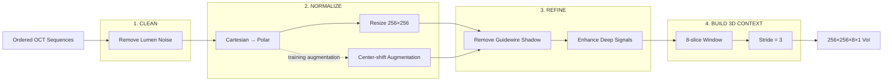

# 03. Preprocessing Pipeline

> **Goal:** Transform ordered 2D OCT sequences into clean, standardized, and context-aware 3D inputs for segmentation.

---

## 1. Pipeline at a Glance

Raw OCT frames are not directly suitable for 3D segmentation because they contain imaging noise, circular vessel geometry, guidewire artifacts, weak deep-tissue signals, and limited context in a single frame.

I designed the pipeline around four stages:

> **1. Clean → 2. Normalize → 3. Refine → 4. Build 3D Context**



---

# Stage 1 — Clean

## 2. Remove Lumen-region Noise

### Why

The lumen may contain:

- guidewire-related reflections
- residual blood
- other signals unrelated to vessel-wall calcification

These regions can introduce distracting features during training.

### What I Did

- Used a **U-Net-based lumen segmentation model** to identify the lumen region
- Removed pixels inside the detected lumen
- Converted the image to **single-channel grayscale**

### Output

> **Clean grayscale OCT frame focused on the vessel wall**

---

# Stage 2 — Normalize

## 3. Convert Cartesian OCT to Polar Representation

### Why

In the original image, the vessel wall forms a circular structure around the catheter.

This geometry makes tissue depth and vessel-wall position less directly aligned with the image axes.

### What I Did

- Used the catheter center as the origin of the transformation
- Unwrapped the circular vessel wall into a rectangular **polar representation**
- Resampled the result to **256 × 256**

### How to Read the Polar Image

| Axis | Meaning |
|---|---|
| Horizontal | Position around the vessel |
| Vertical | Tissue depth from lumen toward vessel wall |

The transformation makes vessel-wall structure more consistent across images and easier to process downstream.

---

## 4. OCT-specific Center-shift Augmentation

### Why

Using exactly the same catheter center for every transformation may make the model too dependent on one geometric representation.

### What I Did

Generated additional polar images using four shifted transformation centers:

```text
Original: (x, y)

Shifted:
(x + 10, y)
(x - 10, y)
(x, y + 10)
(x, y - 10)
```

### Why This Is Different from Generic Augmentation

Instead of simply rotating or translating the processed image, the augmentation changes the **polar transformation itself**.

This creates realistic geometric variation while preserving the underlying vessel structure.

---

# Stage 3 — Refine

## 5. Remove Guidewire Shadow

### Why

The guidewire produces a low-intensity shadow that can hide vessel-wall information and resemble weak tissue signals.

### Key Insight

The guidewire shadow is not random.

Across consecutive OCT frames it forms a **continuous low-intensity trajectory**.

### What I Did

```text
Polar OCT Frames
      ↓
Aggregate Pixel Intensities
      ↓
Stack Consecutive Frames
      ↓
Detect Continuous Dark Trajectory
      ↓
Dynamic Programming
      ↓
Remove Guidewire-shadow Region
```

Instead of detecting the shadow independently in every frame, the method uses its continuity across the pullback.

### Output

> **OCT sequence with guidewire-shadow interference removed**

---

## 6. Enhance Weak Deep-tissue Signals

### Why

OCT signal intensity decreases with imaging depth.

As a result:

> shallow tissue → stronger signal  
> deep tissue → weaker signal

A uniform brightness adjustment would enhance both regions equally and could reduce useful contrast.

### What I Did

Applied **depth-aware enhancement**, where deeper regions receive stronger enhancement than shallow regions.

```text
Shallow Tissue
Lower Enhancement
      ↓
      ↓ increasing depth
      ↓
Higher Enhancement
Deep Tissue
```

### Design Goal

- preserve existing shallow-tissue contrast
- strengthen weak deep-tissue structures
- make subtle calcification boundaries easier to learn

---

# Stage 4 — Build 3D Context

## 7. Construct 3D Volumes of Interest

### Why

A single OCT frame only shows one vessel cross-section.

Calcified lesions often continue across neighboring frames, so isolated 2D processing loses useful longitudinal information.

### What I Did

Used a sliding window to group consecutive frames into **3D Volumes of Interest (VoIs)**.

| Parameter | Setting |
|---|---:|
| Image size | **256 × 256** |
| Window depth | **8 slices** |
| Stride | **3 slices** |
| Channel | **1** |
| Model input | **256 × 256 × 8 × 1** |

### Sliding-window Design

```text
Frames:  1  2  3  4  5  6  7  8  9 10 11 12 13 14

VoI 1:  [1  2  3  4  5  6  7  8]

VoI 2:           [4  5  6  7  8  9 10 11]

VoI 3:                    [7  8  9 10 11 12 13 14]
```

Because **window depth = 8** and **stride = 3**, neighboring VoIs overlap.

---

## 8. Why Overlap Matters

The overlapping design provides two benefits.

### A. More Longitudinal Context

The same OCT slice can appear with different neighboring frames.

This gives the model multiple views of the same lesion context.

### B. Lower Boundary Sensitivity

A lesion near the edge of one VoI may appear near the center of another.

This reduces dependence on where the sliding window happens to start.

---

## 9. End-to-End Transformation

The complete preprocessing workflow transforms:

```text
Raw 704×704 OCT Frames
        ↓
Lumen Cleanup
        ↓
Polar Representation
        ↓
Guidewire-shadow Removal
        ↓
Depth-aware Enhancement
        ↓
3D Sliding Window
        ↓
256×256×8×1 VoIs
```

### Pipeline Summary

| Stage | Input Problem | Engineering Response | Output |
|---|---|---|---|
| **Clean** | Lumen noise | Remove irrelevant lumen signals | Clean grayscale frame |
| **Normalize** | Circular OCT geometry | Polar transformation | 256×256 polar image |
| **Refine** | Artifact + weak signals | Shadow removal + depth enhancement | Cleaner vessel-wall features |
| **Build 3D Context** | Limited 2D information | 8-slice overlapping VoIs | 256×256×8×1 input |

---

## 10. Output

### P3 Output

> **Standardized 256 × 256 × 8 × 1 3D VoIs**

These inputs are shared across the model architectures evaluated in P4.

### Pipeline Boundary

P3 ends at **model input construction**.

Full-vessel reconstruction happens later:

```text
VoI Predictions
      ↓
Map Back to Original Frames
      ↓
Average Overlapping Probabilities
      ↓
Threshold = 0.5
      ↓
Full-vessel 3D Prediction
```

That belongs to **P5 — Evaluation & Results**.

[Next: Model Design →](04_model_design.md)
