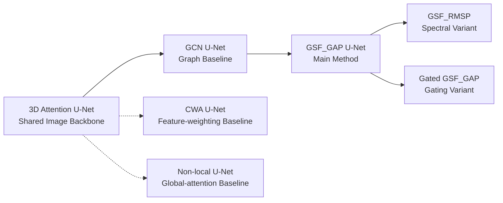

# 04. Model Design

[← Back to README](../README.md#p4--model-design)

This project uses a **shared 3D segmentation backbone** and a controlled set of graph, spectral, and comparison modules to study how long-range context should be represented and propagated.

## Model Design Strategy

The design progression is:

> **3D feature extraction → explicit graph relations → frequency-aware graph filtering**

The backbone is kept fixed across downstream models so architectural comparisons focus on the added relational and spectral components.

---

## Model Taxonomy

| Model | Role | What It Tests |
|---|---|---|
| **U-Net** | Image baseline | Performance of the shared 3D CNN backbone |
| **GCN U-Net** | Graph baseline | Value of explicit graph representation and message passing |
| **GSF_GAP U-Net** | Main proposed method | Frequency-aware graph feature reweighting before GraphConv |
| **GSF_RMSP U-Net** | GSF ablation | Energy-based frequency descriptor instead of signed averaging |
| **Gated GSF_GAP U-Net** | GSF ablation | Learnable soft gating on frequency weights |
| **CWA U-Net** | Comparison baseline | Image-space feature reweighting without graph construction |
| **Non-local U-Net** | Comparison baseline | Dense global-context modeling without a graph |

---

## Shared Architecture Principle

All core models use the same selected **3D Attention U-Net backbone**:

- **Input:** `256 × 256 × 8 × 1`
- **Base channels:** `32`
- **Normalization:** GroupNorm
- **Multi-scale context:** ASPP with dilation rates `3 / 6 / 9`
- **Cross-slice context:** depth-dilated Conv3D
- **Decoder:** attention-gated skip connections

This shared backbone provides a controlled starting point before graph-specific modules are introduced.

[Backbone & Configuration Selection →](models/04a_shared_backbone.md)

---

## Technical Deep Dives

| Topic | Engineering Focus | Deep Dive |
|---|---|---|
| **3D Backbone** | Backbone selection, multi-scale feature extraction, cross-slice context | [04a — Shared Backbone](models/04a_shared_backbone.md) |
| **Graph Representation** | Feature-to-node projection, 128-node KNN graph, residual GraphConv | [04b — Graph Representation](models/04b_graph_representation.md) |
| **Graph Structural Filtering** | GFT, Frequency SE, spectral reweighting, GAP/RMSP/gating variants | [04c — Graph Structural Filtering](models/04c_graph_structural_filtering.md) |
| **Comparison Models** | CWA feature reweighting and Non-local global attention | [04d — Comparison Models](models/04d_comparison_models.md) |

---

## What the Experiments Isolate

The model family is structured to separate four questions:

1. **Backbone:** Can the shared 3D CNN capture enough spatial and cross-slice context?
2. **Graph modeling:** Does an explicit graph improve long-range feature interaction?
3. **Structural Filtering:** Can graph-frequency reweighting refine features before message passing?
4. **Design choice:** How do GAP, RMSP, and soft gating change the GSF behavior?

CWA and Non-local U-Net provide alternative non-graph comparison strategies so the evaluation is not limited to CNN-versus-GNN comparisons.

---

## Next

Continue with the first technical deep dive:

**[04a — Backbone & Configuration Selection →](models/04a_shared_backbone.md)**
