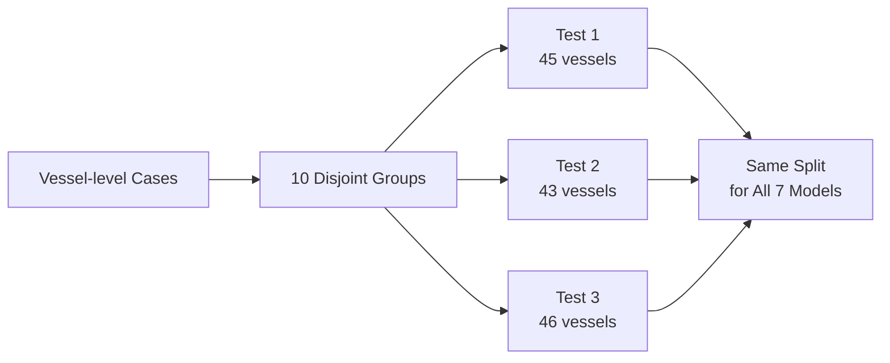
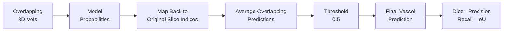

# 05. Model Validation & Results

[← Back to README](../README.md#p5--model-validation--results) · [← Model Design](04_model_design.md)

The validation stage was designed to answer one engineering question:

> **Do the added graph and structural-filtering components improve the final vessel-level segmentation in a controlled and repeatable way?**

Rather than relying on a single split or individual 3D VoIs, all models were evaluated under the same data conditions and scored after reconstructing complete vessels.

---

## 1. What Needed to Be Validated?

The model family in P4 was built as a controlled progression:

`3D U-Net → GCN U-Net → GSF_GAP U-Net`

The evaluation therefore focused on four questions:

1. **Graph value:** Does explicit graph representation and message passing improve over the shared 3D CNN baseline?
2. **Structural-filtering value:** Does GSF improve the graph representation before GraphConv?
3. **Design behavior:** How do GAP, RMSP, and soft gating change Precision–Recall behavior?
4. **Alternative strategies:** How do graph-based models compare with CWA and dense Non-local attention?

---

## 2. Controlled Experiment Design

Vessel-level cases were shuffled into **10 mutually exclusive groups**.

Three different groups were reserved as independent test sets:

| Experiment | Test Vessels | Usage |
|---|---:|---|
| **Test 1** | 45 | Final inference only |
| **Test 2** | 43 | Final inference only |
| **Test 3** | 46 | Final inference only |
| **Total** | **134** | Three mutually exclusive test groups |

For each experiment:

- the selected test group remained fixed,
- the remaining nine groups were reshuffled into **8 training groups + 1 validation group**,
- all seven models used the **same training, validation, and test cases**,
- validation loss selected the best checkpoint,
- test data did not participate in model selection.

### Shared Training Conditions

| Parameter | Setting |
|---|---|
| **Input** | `256 × 256 × 8 × 1` |
| **Optimizer** | Adam |
| **Initial learning rate** | `1e-4` |
| **Loss** | Dice loss |
| **Batch size** | 2 |
| **Maximum epochs** | 50 |
| **Checkpoint** | Minimum validation loss |
| **Inference threshold** | 0.5 |

> **Why this matters:** architecture comparisons are easier to interpret when data splits, preprocessing, optimization conditions, and checkpoint logic are held constant.

---

## 3. Vessel-level Evaluation Pipeline

The model predicts overlapping **8-slice VoIs with stride 3**, so multiple VoIs can produce predictions for the same original slice.

Evaluation is therefore performed only after reconstructing the final vessel-level output.

This prevents overlapping VoIs or individual frames from being treated as independent test cases.

> **Evaluation unit:** one reconstructed whole vessel.

---

## 4. Metrics & Aggregation

The metrics were selected to separate **overall overlap** from **prediction behavior**.

| Metric | What It Reveals |
|---|---|
| **3D Dice** | Overall overlap between predicted and annotated calcification |
| **Precision** | False-positive control |
| **Recall** | Lesion coverage / false-negative behavior |
| **IoU** | Overall region agreement |

Each metric was first calculated per vessel, then averaged within each test set.

The reported **3-Test Mean** is the simple average of the three test-set means.

> **Important:** the reported `Mean ± SD` across tests uses the **three experiment means** as observations. The SD therefore describes cross-split variation and is not the pooled case-level SD across all 134 vessels.

---

## 5. Architecture Decision Evidence

The clearest result is the controlled progression from the convolutional baseline to graph modeling and then structural filtering.

| Architecture Stage | Mean 3D Dice | Change | Interpretation |
|---|---:|---:|---|
| **3D U-Net** | 0.818 | — | Shared convolutional baseline |
| **GCN U-Net** | 0.823 | +0.005 | Small gain from explicit graph representation and message passing |
| **GSF_GAP U-Net** | **0.834** | **+0.011 vs. GCN** | Largest stage gain after structural filtering |
|  |  | **+0.016 vs. U-Net** | Best overall architecture progression |

### Finding 1 — Graph Modeling Added a Small Gain

`U-Net 0.818 → GCN 0.823`

Graph representation improved the three-test mean Dice, but the gain was limited.

**Engineering interpretation:** explicit long-range message passing added useful relational context, but graph construction alone did not produce the strongest result.

### Finding 2 — Structural Filtering Produced the Largest Stage Gain

`GCN 0.823 → GSF_GAP 0.834`

Adding graph-frequency decomposition and adaptive reweighting before GraphConv produced the largest improvement in the architecture progression.

**Engineering interpretation:** refining graph features before propagation was more valuable than simply adding graph message passing to the shared backbone.

---

## 6. Prediction Behavior

The GSF variants changed the model's behavior more than they changed the overall ranking.

| Model | Prediction Tendency | Result |
|---|---|---|
| **U-Net** | More inclusive | Highest Recall, more false positives |
| **GSF_GAP** | Balanced | Highest mean Dice |
| **GSF_RMSP** | More conservative | Highest Precision, lower Recall |
| **Gated GSF_GAP** | Mildly conservative | Higher Precision, no extra Dice gain |

### What the Variants Taught Us

**RMSP** emphasizes response magnitude rather than signed average response.

That shift increased Precision to **0.824**, but Recall dropped to **0.834**.

**Soft gating** also pushed the model toward a more conservative prediction pattern. Precision increased, but the additional filtering did not improve mean Dice over GSF_GAP.

> **Engineering takeaway:** more selective filtering was not automatically better. The strongest overall result came from maintaining a better balance between lesion coverage and false-positive suppression.

---

## 7. Reliability Checks

### Repeated Testing

Model ranking changed across the three test sets.

GSF_GAP achieved the best result in Test 1, while Gated GSF_GAP ranked highest in Test 2 and Test 3. However, GSF_GAP achieved the highest **three-test mean** and the lowest cross-test SD among the GSF variants.

This is why the final model decision was based on repeated evaluation rather than a single best split.

### Paired Case-level Comparison

The same 134 test vessels were evaluated by every model, enabling paired comparison of vessel-level 3D Dice.

| Comparison | Raw p-value |
|---|---:|
| **GSF_GAP vs. U-Net** | 0.0233 |
| **GSF_GAP vs. GCN** | 0.0188 |
| **GSF_GAP vs. CWA** | 0.0167 |
| **GSF_GAP vs. Non-local** | 0.0003 |
| **GSF_GAP vs. GSF_RMSP** | 0.1095 |
| **GSF_GAP vs. Gated GSF_GAP** | 0.3620 |

The GSF_GAP comparisons with U-Net, GCN, CWA, and Non-local were below the unadjusted `p < 0.05` threshold.

The differences among the GSF variants were not strong enough to support clear statistical separation.

> **Statistical boundary:** 21 pairwise tests were performed without multiple-comparison correction. These raw p-values are therefore treated as **exploratory evidence**, not confirmatory proof of model superiority.

---

## 8. Failure Analysis

Quantitative performance alone did not explain where architecture changes helped or where all models still struggled.

Three representative patterns were especially informative:

| Case Pattern | Observation | Engineering Implication |
|---|---|---|
| **Deep low-contrast boundary** | Graph and GSF models often produced more continuous contours, but all models could underestimate deep lesion extent | Better feature modeling cannot recover image information that is not present |
| **Long arc with heterogeneous texture** | Graph-based models showed more continuous long-range contours in representative cases | Relational modeling may be most useful when lesion structure spans multiple local regions |
| **Small clear lesion** | Differences between models were limited when local image evidence was already strong | Additional graph complexity is not equally valuable for every case |

These visual examples are used as **supporting evidence**, not as a substitute for whole-dataset quantitative evaluation.

---

## 9. What the Results Support

The experiments support three practical conclusions:

1. **Graph modeling provided incremental value** over the shared 3D CNN baseline.
2. **Graph Structural Filtering produced the strongest architecture-stage improvement** in mean vessel-level Dice.
3. **More aggressive frequency selection did not automatically improve the final result**; RMSP and soft gating mainly shifted the Precision–Recall trade-off.

The results do **not** establish that graph-based architectures are universally superior to all global-attention methods or that GSF_GAP is definitively superior to every GSF variant.

---

## Engineering Takeaways

- Built a controlled validation framework where architecture changes were evaluated under the same data and training conditions.
- Evaluated the **final vessel-level output**, not overlapping VoIs as independent samples.
- Used repeated test groups to expose ranking changes that a single split could hide.
- Combined overlap metrics with Precision and Recall to understand **how** architecture changes affected predictions.
- Used paired case-level analysis to support model comparisons while keeping statistical claims within the limits of the experiment.
- Identified deep low-contrast boundaries as a remaining bottleneck that additional model complexity alone may not solve.

> **Next validation priorities:** full cross-validation, external-center validation, boundary-based metrics, graph-construction ablations, and direct visualization of learned graph-frequency behavior.
