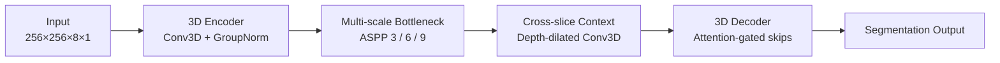

# 04a. Backbone & Configuration Selection

[← Model Design Hub](../04_model_design.md)

> **Goal:** Select and freeze a stable 3D backbone before testing graph-specific components.

The shared backbone was selected **before** introducing graph modules so downstream comparisons could focus on GCN and GSF design changes rather than changes to the underlying encoder-decoder.

## 1. Backbone Configuration Selection

Two integrated backbone configurations were compared using a **dedicated 45-vessel configuration-selection set**, separate from the reserved final test sets.

| Component | Previous | Selected |
|---|---:|---:|
| **Input shape** | `256 × 256 × 5 × 1` | **`256 × 256 × 8 × 1`** |
| **Input depth** | 5 slices | **8 slices** |
| **Base channels** | 8 | **32** |
| **Normalization** | BatchNorm | **GroupNorm** |

The selected configuration increased the available cross-slice context and feature capacity while replacing batch-dependent normalization with GroupNorm for small-batch 3D training.

### Selection Result

| Metric | Previous | Selected |
|---|---:|---:|
| **Mean 3D Dice** | 0.754 ± 0.134 | **0.758 ± 0.134** |
| **Median 3D Dice** | 0.785 | **0.794** |
| **Vessels** | 45 | 45 |

The selected configuration was then **held fixed across downstream models**.

> **Important:** input depth, base channels, and normalization were changed together. The result supports the configuration as a whole; it does not isolate the effect of any single change.

---

## 2. Shared 3D Attention U-Net

The selected backbone provides the common 3D feature representation used by U-Net, GCN U-Net, and the GSF model family.



### Encoder

Each encoder block uses:

- two Conv3D layers,
- Group Normalization,
- ReLU activation,
- SpatialDropout3D with rate `0.2`.

Downsampling uses `MaxPooling3D(2, 2, 1)`, reducing spatial resolution while **preserving all 8 slices along the depth axis**.

This keeps longitudinal context available throughout the encoder instead of collapsing the slice dimension early.

---

## 3. Multi-scale & Cross-slice Context

The bottleneck combines two complementary receptive-field strategies.

### ASPP — Multi-scale Spatial Context

ASPP processes the bottleneck features with multiple dilation rates:

`3 · 6 · 9`

This expands the in-plane receptive field and helps the model represent calcified regions with different shapes and spatial extents.

### Depth-dilated Conv3D — Longitudinal Context

A depth-dilated 3D convolution with depth dilation `2` expands the receptive field along the slice axis.

This allows the backbone to integrate information across neighboring OCT frames before any graph representation is introduced.

---

## 4. Attention-guided Decoder

The decoder restores spatial resolution using attention-gated skip connections.

Instead of passing every encoder feature directly into the decoder, the decoder gating signal weights the corresponding encoder feature before concatenation.

> **Purpose:** reduce irrelevant background features entering the decoder while preserving high-resolution information needed for boundary reconstruction.

---

## 5. Why Keep the Backbone Fixed?

The backbone acts as the **control architecture** for the graph experiments.

```text
Shared 3D Backbone
        │
        ├── U-Net
        ├── GCN U-Net
        ├── GSF_GAP U-Net
        ├── GSF_RMSP U-Net
        └── Gated GSF_GAP U-Net
```

Keeping the same input configuration and core feature extractor makes the downstream comparison easier to interpret:

- **U-Net** measures the shared CNN backbone alone.
- **GCN U-Net** adds explicit graph representation and message passing.
- **GSF models** add graph structural filtering before message passing.

This creates a controlled architecture progression instead of comparing unrelated networks.

---

## Key Takeaways

- Selected the backbone on a **separate configuration-selection split** before final model evaluation.
- Increased input depth from **5 to 8 slices** to expose the model to longer longitudinal context.
- Used **GroupNorm** so normalization does not depend on mini-batch statistics during batch-size-2 3D training.
- Preserved the depth axis during encoder pooling with `(2, 2, 1)`.
- Combined **ASPP + depth-dilated Conv3D** to capture both multi-scale spatial context and cross-slice context.
- Fixed the selected backbone across downstream graph models to support controlled architecture comparisons.

---

## Next

The next step converts dense CNN features into an explicit graph representation:

**[04b — Graph Representation & GCN Baseline →](04b_graph_representation.md)**
