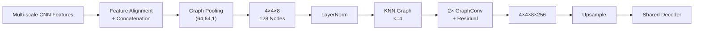
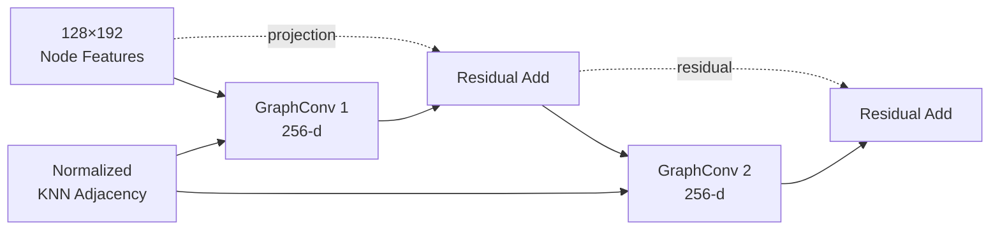

# 04b. Graph Representation & GCN Baseline

[← Model Design Hub](../04_model_design.md) · [← Backbone](04a_shared_backbone.md)

The GCN baseline extends the shared 3D CNN backbone with an explicit graph representation so feature-similar regions can exchange information even when they are far apart in the original image grid.

## 1. Why Add a Graph?

Convolution is effective at extracting local and multi-scale image features, but long-range interactions are still built indirectly through stacked receptive fields.

The graph branch adds a second representation:

> **CNN features describe what is present locally; the graph describes which learned regions should interact.**

This creates a controlled baseline for testing whether explicit relational message passing adds value beyond the shared 3D backbone.

---

## 2. Feature-to-Graph Pipeline



The key engineering step is converting dense 3D CNN features into a **compact graph representation** before message passing.

---

## 3. Multi-scale Feature Fusion

Encoder features from different resolutions are first aligned to a common spatial size and channel width, then concatenated into a fused feature tensor.

After fusion, each spatial location is represented by a **192-dimensional feature vector**.

This gives the graph branch access to both:

- lower-level spatial detail,
- higher-level semantic context.

The graph is therefore built from a richer representation than a single bottleneck feature map.

---

## 4. Graph Pooling: Dense Features → 128 Nodes

Using every position in a `256 × 256 × 8` feature volume as a graph node would make the adjacency matrix and later graph operations unnecessarily expensive.

The fused feature map is therefore downsampled with:

`MaxPooling3D(pool_size = (64, 64, 1))`

which converts:

`256 × 256 × 8 → 4 × 4 × 8`

and produces:

`4 × 4 × 8 = 128 graph nodes`

The depth pooling factor remains `1`, so the full **8-slice structure is preserved**.

After reshaping, the node feature matrix is:

`X ∈ R^(128 × 192)`

> **Engineering trade-off:** reduce graph size enough for practical adjacency and spectral computation without collapsing the longitudinal dimension.

---

## 5. KNN Graph Construction

Before graph construction, **Layer Normalization** is applied across each node's feature channels to reduce scale differences during distance computation.

For each node:

1. compute pairwise squared Euclidean distance in feature space,
2. select the `k=4` nearest non-self neighbors,
3. create a binary directed KNN adjacency,
4. symmetrize the adjacency to form an undirected graph.

```text
Node Features
     ↓
LayerNorm
     ↓
Pairwise Feature Distance
     ↓
Top-4 Nearest Neighbors
     ↓
Symmetric Binary KNN Graph
```

Because the graph is built in **feature space rather than image distance**, spatially distant regions can become direct neighbors when their learned representations are similar.

> `k=4` controls the number of neighbors each node actively selects before graph symmetrization.

---

## 6. GCN Message Passing

The GCN baseline adds a self-loop to the KNN adjacency and applies symmetric adjacency normalization before propagation.

Two GraphConv layers are used:

- **GraphConv 1:** outputs 256-dimensional node features and adds a projected residual from the original node representation.
- **GraphConv 2:** outputs 256-dimensional node features and adds a residual from the first graph layer.

The residual path helps preserve the original representation while relational information is aggregated from neighboring nodes.



---

## 7. Back to the CNN Decoder

After graph message passing, the node features are reshaped back into a 3D feature grid:

`128 × 256 → 4 × 4 × 8 × 256`

The graph feature map is then upsampled to the backbone bottleneck resolution and passed into the shared decoder.

This makes the graph branch compatible with the original encoder-decoder pipeline:

> **CNN → Graph → CNN**

The graph is used as an intermediate relational representation rather than replacing the segmentation network.

---

## 8. Why This Baseline Matters

GCN U-Net is not only another model variant. It establishes the reference point for the proposed GSF method.

| Model | Added Capability |
|---|---|
| **U-Net** | 3D image feature extraction |
| **GCN U-Net** | Explicit graph construction + long-range message passing |
| **GSF U-Net** | Structural filtering before graph message passing |

This progression isolates the question:

> **Does refining graph features before propagation add value beyond standard GCN message passing?**

That question motivates Graph Structural Filtering in the next stage.

---

## Engineering Takeaways

- Converted dense multi-scale CNN features into a compact **128-node graph representation**.
- Preserved all **8 slices** during graph pooling with a depth pooling factor of `1`.
- Normalized node features before KNN construction to make feature-space distance more stable.
- Built a symmetric `k=4` KNN graph from learned feature similarity rather than physical proximity.
- Used **two residual GraphConv layers** to aggregate long-range relational context.
- Reshaped graph features back into a 3D tensor so the graph branch integrates cleanly with the shared decoder.

> **Scope note:** `128 nodes` and `k=4` were fixed design choices in this study. They were not exhaustively optimized across node resolutions or graph-construction strategies.

---

## Next

The GCN baseline performs message passing on the constructed graph without frequency-aware feature refinement. The next stage adds **Graph Structural Filtering** before message passing:

**[04c — Graph Structural Filtering →](04c_graph_structural_filtering.md)**
