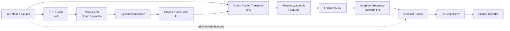

# 04c. Graph Structural Filtering

[← Model Design Hub](../04_model_design.md) · [← Graph Representation](04b_graph_representation.md)

> **Goal:** Refine graph features in the graph-frequency domain before GraphConv while keeping the underlying KNN graph fixed.

Graph Structural Filtering (GSF) extends the GCN baseline by refining graph features **before message passing**.

> **Core idea:** keep the same KNN graph, decompose node features into graph-frequency components, learn their relative importance, then reweight and fuse them before GraphConv.

## 1. Why Add Structural Filtering?

The GCN baseline builds a KNN graph from feature similarity and propagates information across connected nodes.

However, feature similarity alone does not imply that every graph-frequency component should contribute equally to downstream message passing.

GSF therefore asks:

> **Can graph features be refined before propagation so GraphConv operates on a more selective representation?**

GSF changes the **node-feature representation** used for propagation without deleting or rebuilding individual KNN edges.

---

## 2. Architecture Flow



The processing logic is:

1. **Build the graph basis** from the KNN graph.
2. **Decompose node features** into graph-frequency components.
3. **Learn and apply frequency weights** with Frequency SE.
4. **Fuse filtered and original node features** before GraphConv.

---

## 3. Graph-frequency Decomposition

GSF starts from the same symmetric `k=4` KNN graph used by the GCN baseline.

For the graph-frequency branch:

- diagonal self-loops are removed,
- a normalized graph Laplacian is constructed,
- the Laplacian is symmetrized and stabilized with `1e-5 I`,
- eigendecomposition produces the graph Fourier basis `U`.

With **128 graph nodes**, the Laplacian produces **128 graph-frequency components**.

The node feature matrix is projected into the graph-frequency domain through:

`UᵀX`

The resulting coefficients are combined with the Fourier basis to form frequency-specific node features with the conceptual shape:

`Node × Channel × Frequency = 128 × 192 × 128`

Lower graph frequencies correspond to smoother variation across connected nodes, while higher frequencies represent faster changes over the graph. GSF does not assume one range is always better; the relative contribution is learned from the input representation.

---

## 4. Frequency SE & Residual Fusion

The main model, **GSF_GAP U-Net**, learns one weight for each of the 128 graph-frequency components.

### Frequency Descriptor

Global Average Pooling is applied across the node and channel dimensions of each frequency-specific feature, producing a:

`128-dimensional frequency descriptor`

### Frequency Excitation

The descriptor passes through a two-layer MLP:

`128 → 8 → 128`

with:

- reduction ratio = `16`
- ReLU in the hidden layer
- sigmoid output

This produces one input-dependent weight in `(0, 1)` for each graph frequency.

```text
Frequency-specific Features
          ↓
Global Average Pooling
          ↓
128-d Frequency Descriptor
          ↓
FC: 128 → 8 → 128
          ↓
Sigmoid Frequency Weights
```

Each frequency-specific feature is multiplied by its learned weight and summed across the frequency dimension.

The reweighted graph-frequency feature is then fused with the original node representation:

`GSF-enhanced features = original node features + reweighted graph-frequency features`

The residual path makes the graph-frequency branch an **augmentation of the original representation**, rather than a replacement.

---

## 5. Graph Propagation After GSF

The GSF-enhanced node features are passed into the same two-layer GraphConv structure used for relational message passing.

For the GSF family:

- the propagation matrix uses the symmetric KNN adjacency,
- no self-loop is added to the GSF propagation matrix,
- GraphConv 1 outputs 256-dimensional node features with a projected residual,
- GraphConv 2 adds a second residual connection.

The output is reshaped to:

`4 × 4 × 8 × 256`

then upsampled and passed to the shared decoder.

The full path is therefore:

> **CNN features → graph construction → Graph Structural Filtering → GraphConv → decoder**

---

## 6. GSF Design Variants

The GSF variants change only specific decisions inside the filtering module.

### GSF_GAP — Main Method

**Descriptor:** Global Average Pooling

GAP summarizes the **mean signed response** of each graph-frequency component.

---

### GSF_RMSP — Frequency Descriptor Ablation

GSF_RMSP changes only the squeeze operation in Frequency SE.

Instead of averaging signed responses, Root Mean Square Pooling summarizes response magnitude.

Example:

`[+3, -3, +4, -4]`

- GAP → `0`
- RMSP → retains the non-zero magnitude

| Variant | Descriptor | Interpretation |
|---|---|---|
| **GSF_GAP** | Global Average Pooling | Mean signed frequency response |
| **GSF_RMSP** | Root Mean Square Pooling | Frequency magnitude independent of sign |

This isolates the question:

> **Should frequency importance be described by signed average response or response magnitude?**

---

### Gated GSF_GAP — Soft-filtering Ablation

The gated variant keeps GAP-based Frequency SE and adds a **learnable soft threshold** before frequency reweighting.

For each frequency:

1. Frequency SE produces weight `w`.
2. A learnable scalar threshold `τ` is constrained to `(0,1)` with sigmoid.
3. A soft passing ratio is computed from the difference between `w` and `τ`.
4. The final gated weight combines the SE weight and passing ratio.

The threshold is initialized at **0.5** and optimized jointly with the network.

Because the gate uses sigmoid, the operation remains **continuous and differentiable** rather than performing hard keep/drop filtering.

This isolates a second question:

> **Does additional soft suppression of lower-weight frequency components improve the GSF representation?**

---

## 7. What GSF Does — and Does Not Do

### GSF does

- keep the KNN graph fixed,
- derive a graph Fourier basis from that graph,
- decompose node features into graph-frequency components,
- learn frequency-level importance,
- reweight and residual-fuse graph-frequency features before GraphConv.

### GSF does not

- delete individual KNN edges,
- rebuild the graph after frequency analysis,
- apply hard keep/drop decisions to frequencies,
- replace GraphConv with a frequency-only network.

> GSF changes **what graph-feature information is emphasized before propagation**, not **which KNN edges exist**.

---

## Key Takeaways

- Added **Graph Structural Filtering before GraphConv** while keeping the underlying KNN graph fixed.
- Used the normalized graph Laplacian and eigendecomposition to obtain **128 graph-frequency components**.
- Built a Frequency SE module with a **128 → 8 → 128** bottleneck for input-dependent frequency weighting.
- Used **residual fusion** so graph-frequency features augment rather than replace the original node representation.
- Designed **GAP, RMSP, and soft-gating ablations** to isolate frequency-description and filtering choices.
- Kept the filtered representation compatible with the existing two-layer GraphConv and shared decoder.

> **Scope note:** the learned frequency weights were not directly mapped to specific anatomical structures in this study. Their effect is evaluated through controlled model comparisons and downstream segmentation performance.

---

## Next

The final model-design page covers alternative non-GSF comparison strategies:

**[04d — Comparison Models →](04d_comparison_models.md)**
