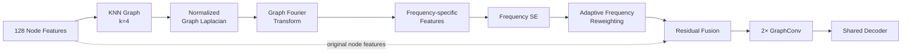

# 04c. Graph Structural Filtering

[← Model Design Hub](../04_model_design.md) · [← Graph Representation](04b_graph_representation.md)

Graph Structural Filtering (GSF) extends the GCN baseline by refining graph features **before message passing**.

> **Core idea:** keep the same KNN graph, decompose node features into graph-frequency components, learn which components matter, then reweight and fuse them before GraphConv.

## 1. Why Add Structural Filtering?

The GCN baseline builds a KNN graph from feature similarity and propagates information across connected nodes.

However, feature similarity alone does not guarantee that every graph signal is equally useful for segmentation.

GSF therefore asks a more specific question:

> **Can the node representation be filtered before graph propagation so GraphConv operates on a more selective graph signal?**

This changes the processing of graph features without directly deleting or rebuilding KNN edges.

---

## 2. GSF Processing Flow



The GSF branch has three main stages:

1. **Decompose** node features into graph-frequency components.
2. **Score and reweight** the relative contribution of each frequency.
3. **Fuse** the filtered representation with the original node features before GraphConv.

---

## 3. Graph-frequency Decomposition

GSF starts from the same symmetric KNN graph used by the GCN baseline.

For the spectral branch:

- diagonal self-loops are removed,
- the adjacency matrix is symmetrized,
- a normalized graph Laplacian is constructed,
- a small `1e-5 I` term is added for numerical stability,
- eigendecomposition produces the graph Fourier basis.

With **128 graph nodes**, the Laplacian produces **128 graph-frequency components**.

The Graph Fourier Transform projects the node feature matrix from the node domain into the graph-frequency domain.

> Lower-frequency components represent smoother variation across connected nodes, while higher-frequency components represent faster changes across the graph structure.

The purpose here is not to classify frequencies as universally good or bad. The model learns their relative contribution from the input features.

---

## 4. Frequency-specific Features

The transformed coefficients are mapped back through the graph Fourier basis to form frequency-specific node features.

Conceptually, the representation becomes:

`Node × Channel × Frequency`

with:

- **128 nodes**
- **192 feature channels**
- **128 graph frequencies**

Each frequency therefore has its own contribution across nodes and channels.

This representation lets the model evaluate graph structure at the **frequency-component level** instead of treating the full node feature matrix as one undifferentiated signal.

---

## 5. Frequency Squeeze-and-Excitation

The main model, **GSF_GAP U-Net**, uses a Frequency SE module to learn one importance weight per graph frequency.

### Squeeze

Global Average Pooling is applied across the node and channel dimensions of each frequency-specific feature.

This produces a:

`128-dimensional frequency descriptor`

### Excitation

The descriptor passes through a two-layer MLP:

`128 → 8 → 128`

with:

- reduction ratio = `16`
- ReLU in the hidden layer
- sigmoid output

The result is a learned weight in `(0, 1)` for each graph-frequency component.

```text
Frequency-specific Features
          ↓
Global Average Pooling
          ↓
128-d Frequency Descriptor
          ↓
FC: 128 → 8
          ↓
FC: 8 → 128 + Sigmoid
          ↓
128 Frequency Weights
```

> **Engineering role:** learn input-dependent frequency importance before graph message passing.

---

## 6. Frequency Reweighting & Residual Fusion

Each frequency-specific feature is multiplied by its learned weight and then aggregated across the frequency dimension.

The resulting spectral feature has the same node-feature shape as the original representation.

GSF then performs residual fusion:

`GSF-enhanced features = original node features + reweighted spectral features`

This design is important because the spectral branch **supplements the original node representation instead of replacing it**.

The residual path preserves the original CNN-derived graph features while allowing the spectral branch to adjust their relative structural content.

---

## 7. Graph Propagation After GSF

The GSF-enhanced node features are then passed through the same two-layer GraphConv structure used for graph message passing.

For the GSF family:

- the propagation matrix is built from the symmetric KNN adjacency,
- no self-loop is added in the GSF propagation matrix,
- GraphConv 1 outputs 256-dimensional node features with a projected residual,
- GraphConv 2 adds a second residual connection.

The output is reshaped to:

`4 × 4 × 8 × 256`

then upsampled and passed to the shared decoder.

The full path is therefore:

> **CNN features → graph → structural filtering → graph message passing → decoder**

---

## 8. GSF Design Variants

The variants change only specific decisions inside the GSF module.

### GSF_GAP — Main Method

**Frequency descriptor:** Global Average Pooling

GAP summarizes the **mean signed response** of each graph frequency.

This is the main proposed GSF configuration.

---

### GSF_RMSP — Frequency Descriptor Ablation

GSF_RMSP changes only the squeeze operation inside Frequency SE.

Instead of averaging signed responses, Root Mean Square Pooling summarizes their magnitude.

Example:

`[+3, -3, +4, -4]`

- GAP → `0`
- RMSP → retains the non-zero response magnitude

| Variant | Descriptor | Interpretation |
|---|---|---|
| **GSF_GAP** | Global Average Pooling | Mean signed frequency response |
| **GSF_RMSP** | Root Mean Square Pooling | Frequency energy / magnitude independent of sign |

This ablation tests whether **signed average response or response magnitude** is a better frequency descriptor.

---

### Gated GSF_GAP — Soft-filtering Ablation

The gated variant keeps the GAP-based Frequency SE and adds a **learnable soft threshold** before frequency reweighting.

For each frequency:

1. Frequency SE produces weight `w`.
2. A learnable scalar threshold `τ` is mapped to `(0,1)` with sigmoid.
3. The model computes a soft passing ratio from the difference between `w` and `τ`.
4. The final frequency weight combines the SE weight with this passing ratio.

The threshold is initialized at **0.5** and optimized jointly with the network.

```text
Frequency SE Weight
        ↓
Learnable Threshold
        ↓
Soft Passing Ratio
        ↓
Gated Frequency Weight
        ↓
Frequency Reweighting
```

Because the gate uses a sigmoid, the filtering remains **continuous and differentiable** rather than hard-thresholding frequencies.

---

## 9. What GSF Does — and Does Not Do

This distinction is important.

### GSF does

- keep the KNN graph fixed,
- decompose node features using the graph structure,
- learn frequency-level importance,
- reweight graph-frequency components,
- fuse filtered and original node features before GraphConv.

### GSF does not

- delete individual KNN edges,
- rebuild the graph after spectral analysis,
- assign a hard keep/drop decision to every frequency,
- replace GraphConv with a spectral-only network.

> GSF changes **what information is emphasized before propagation**, not **which graph edges exist**.

---

## 10. Why This Design Matters

The model progression becomes:

| Model | Representation Before Message Passing |
|---|---|
| **GCN U-Net** | Original graph node features |
| **GSF_GAP U-Net** | Frequency-reweighted + residual-fused graph features |
| **GSF_RMSP U-Net** | Same GSF pipeline with magnitude-based frequency descriptors |
| **Gated GSF_GAP U-Net** | GAP-based GSF with additional learnable soft filtering |

This isolates two design questions:

1. **How should graph-frequency importance be described?**  
   GAP vs. RMSP

2. **Should weak frequency components receive additional suppression?**  
   Standard GSF vs. soft-gated GSF

---

## Engineering Takeaways

- Added a **graph-frequency processing stage before GraphConv** without changing the underlying KNN graph.
- Used the normalized graph Laplacian and eigendecomposition to obtain **128 graph-frequency components**.
- Built a Frequency SE module with a **128 → 8 → 128** bottleneck to learn input-dependent frequency weights.
- Used **residual fusion** so the spectral branch augments rather than replaces the original node representation.
- Designed **GAP, RMSP, and soft-gating ablations** to isolate descriptor and filtering choices.
- Kept the final representation compatible with the existing two-layer GraphConv and shared decoder.

> **Scope note:** the learned frequency weights were not directly interpreted as specific anatomical structures in this study. The mechanism is evaluated through controlled model comparisons and downstream segmentation performance.

---

## Next

The final model-design page covers alternative non-GSF comparison strategies:

**[04d — Comparison Models →](04d_comparison_models.md)**
