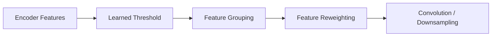
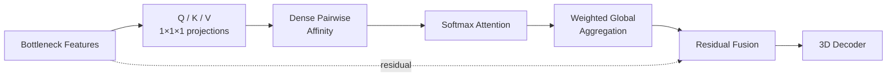

# 04d. Comparison Models

[← Model Design Hub](../04_model_design.md) · [← Graph Structural Filtering](04c_graph_structural_filtering.md)

CWA U-Net and Non-local U-Net are included as **comparison baselines**, not as stages in the GSF architecture.

They represent two alternative ways to improve context modeling without using the proposed graph structural filtering pipeline.

## 1. Comparison Strategy

| Model | Representation | Context Mechanism | Graph Required |
|---|---|---|---:|
| **CWA U-Net** | Image feature maps | Feature grouping and reweighting | No |
| **Non-local U-Net** | Dense bottleneck feature map | All-to-all global attention | No |
| **GCN U-Net** | 128-node graph | KNN message passing | Yes |
| **GSF family** | Graph + frequency | Graph Structural Filtering + message passing | Yes |

The evaluation covers four parallel modeling strategies:

> **Image-space reweighting · Dense global attention · Graph message passing · Graph Structural Filtering**

---

## 2. CWA U-Net — Image-space Feature Reweighting

CWA operates in the image-feature path rather than constructing graph nodes.

The module uses a learned threshold to identify feature groups and reweight selected image information before it is passed deeper into the encoder.

### Why Include CWA?

CWA provides a comparison for **feature reweighting without explicit graph construction**.

It helps answer:

> Can improving the image-space representation alone provide the same benefit as explicitly modeling relationships between regions?

Unlike GCN / GSF:

- there are no graph nodes,
- no KNN adjacency,
- no graph message passing,
- no graph-frequency decomposition.

The comparison therefore tests a different representation strategy rather than a different graph operator.

---

## 3. Non-local U-Net — Dense Global Attention

Non-local U-Net provides a second alternative: model long-range dependencies directly on the regular 3D feature map.

A Non-local block is inserted at the bottleneck.

The block:

1. projects bottleneck features into query, key, and value representations,
2. computes pairwise affinity across all spatial positions,
3. applies softmax to form a dense attention map,
4. aggregates global context,
5. projects the result back and fuses it with the original bottleneck feature through a learnable residual branch.

### Why Include Non-local Attention?

Non-local U-Net tests whether **dense global interaction** can provide long-range context without graph construction.

This creates a useful contrast:

- **Non-local:** every position can interact with every other position.
- **GCN / GSF:** interactions are constrained by a compact KNN graph.

---

## 4. Comparison Logic

The comparison models answer different questions rather than forming one architecture sequence.

| Model | Technical Question |
|---|---|
| **U-Net** | How far can the shared 3D CNN backbone go? |
| **CWA U-Net** | Does image-space feature reweighting improve the representation? |
| **Non-local U-Net** | Does dense global attention improve long-range context? |
| **GCN U-Net** | Does structured graph message passing help? |
| **GSF_GAP U-Net** | Does Graph Structural Filtering refine graph features before message passing? |

This makes the final evaluation more informative than a simple **CNN vs. GNN** comparison.

---

## 5. Interpretation Boundary

The compared architectures differ in more than one implementation detail.

Therefore, the evaluation can show how these **complete modeling strategies perform under the same task**, but it should not be interpreted as proof that one mechanism is universally superior to another.

This distinction is important when interpreting the results in P5.

---

## Engineering Takeaways

- Compared the proposed graph pipeline against both **image-space reweighting** and **graph-free global attention**.
- Used Non-local attention as an explicit long-range baseline without KNN graph construction.
- Kept CWA conceptually separate from graph models because it operates on image features rather than graph topology.
- Structured the comparison around **representation strategy and interaction pattern**, not only model names.

---

## Next

With the model family defined, the next stage evaluates performance across repeated experiments and vessel-level prediction aggregation:

**[P5 — Model Validation & Results →](../05_experiments_results.md)**
